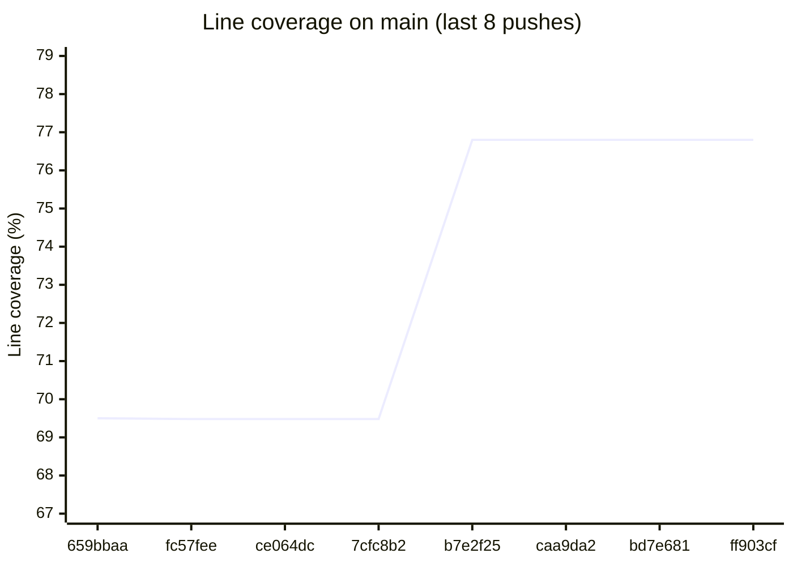

# Code coverage history

Line coverage of `src/eplugin-framework/addons/ePlugin` on `main`, recorded by the CI-PR workflow after every push. This branch is generated; do not edit it.

**76.80%** (6749 of 8788 lines) at [ff903cf](https://github.com/enaweg/godot-epluginframework/commit/ff903cf12369521deb3cd90778bd1d3407543cbe), 2026-10-16.

| Date | Commit | Line coverage | Change |
|:--|:--|--:|--:|
| 2026-10-16 | [ff903cf](https://github.com/enaweg/godot-epluginframework/commit/ff903cf12369521deb3cd90778bd1d3407543cbe) | 76.80% | +0.00 pp |
| 2026-10-16 | [bd7e681](https://github.com/enaweg/godot-epluginframework/commit/bd7e6810f7f41310d2483a1f6a4fc1df2366ea25) | 76.80% | +0.00 pp |
| 2026-10-15 | [caa9da2](https://github.com/enaweg/godot-epluginframework/commit/caa9da2162fca30674b6017e64232cd30cbc9554) | 76.80% | +0.00 pp |
| 2026-10-14 | [b7e2f25](https://github.com/enaweg/godot-epluginframework/commit/b7e2f25c6bde4f431377ff0e97157f6ef01d0a92) | 76.80% | +7.32 pp |
| 2026-10-14 | [7cfc8b2](https://github.com/enaweg/godot-epluginframework/commit/7cfc8b29f72977d4323e61f7ffb55d0aaa2dc2dd) | 69.48% | +0.00 pp |
| 2026-10-14 | [ce064dc](https://github.com/enaweg/godot-epluginframework/commit/ce064dcd5bc338704d9468a1fb171bd364e3c076) | 69.48% | +0.00 pp |
| 2026-10-14 | [fc57fee](https://github.com/enaweg/godot-epluginframework/commit/fc57fee06cb05235d5cafd80d663e2e5797f8ed6) | 69.48% | -0.02 pp |
| 2026-10-14 | [659bbaa](https://github.com/enaweg/godot-epluginframework/commit/659bbaa6769ba1db6a0da1e7bee266b2158f5e74) | 69.50% |  |

All measurements: [history.csv](history.csv).

Files at ff903cf (91)

| File | Line coverage | Covered lines |
|:--|--:|--:|
| `IEEditorPluginExtensions.cs` | 0.0% | 0 of 15 |
| `Internal/EGlobal.PluginManager.cs` | 0.0% | 0 of 39 |
| `Internal/EGlobal.UpdateWorkflow.cs` | 0.0% | 0 of 7 |
| `Internal/Manager/UpdateFailureDialog.cs` | 0.0% | 0 of 50 |
| `Internal/Manager/LicenseDialog.cs` | 7.5% | 12 of 161 |
| `Internal/Manager/UpdateSitesDialog.cs` | 8.2% | 16 of 194 |
| `Internal/Manager/EPluginManagerDialog.cs` | 8.8% | 51 of 580 |
| `Internal/ProjectSettingsDialog.cs` | 9.4% | 5 of 53 |
| `Internal/EGlobal.UpdateApply.cs` | 13.1% | 31 of 237 |
| `Internal/Manager/LocalSourcesDialog.cs` | 18.0% | 16 of 89 |
| `Internal/Manager/WelcomeDialog.cs` | 18.0% | 11 of 61 |
| `Internal/EditorHost.cs` | 21.4% | 9 of 42 |
| `Internal/Manager/EditorWindows.cs` | 33.3% | 18 of 54 |
| `Internal/AssemblyUnloadCleanup.cs` | 38.9% | 7 of 18 |
| `EPlugin.cs` | 44.4% | 4 of 9 |
| `Internal/EGlobal.UpdateSites.cs` | 47.4% | 9 of 19 |
| `Internal/EGlobal.LocalSources.cs` | 54.4% | 31 of 57 |
| `EPluginPlugin.cs` | 62.2% | 156 of 251 |
| `Internal/EGlobal.Updates.cs` | 70.8% | 80 of 113 |
| `Internal/PluginTypes.cs` | 72.2% | 13 of 18 |
| `EditorPluginExtensions.cs` | 75.4% | 46 of 61 |
| `Logging/GodotConsoleLogger.cs` | 76.7% | 33 of 43 |
| `Internal/ProgressSession.cs` | 81.4% | 153 of 188 |
| `Internal/ActivationProgress.cs` | 82.5% | 241 of 292 |
| `Internal/Update/UpdateApplier.cs` | 84.5% | 278 of 329 |
| `Internal/EGlobal.cs` | 85.3% | 850 of 996 |
| `Internal/AssemblyReload.cs` | 85.7% | 24 of 28 |
| `Internal/EGlobal.PlainPlugins.cs` | 87.6% | 127 of 145 |
| `Internal/Welcomes/PluginWelcome.cs` | 87.9% | 29 of 33 |
| `Internal/Manager/EditorIcons.cs` | 88.0% | 22 of 25 |
| `Internal/EGlobal.RecipeOperations.cs` | 88.4% | 61 of 69 |
| `Internal/Update/PackageFiles.cs` | 90.4% | 94 of 104 |
| `Internal/Licenses/PluginLicense.cs` | 91.1% | 41 of 45 |
| `Internal/EEditorPluginBuilder.cs` | 91.3% | 63 of 69 |
| `Internal/Manager/PluginCatalog.cs` | 92.0% | 23 of 25 |
| `Internal/EGlobal.Welcomes.cs` | 93.1% | 67 of 72 |
| `Internal/Update/InterimBridge.cs` | 93.2% | 41 of 44 |
| `Internal/Update/UpdateService.cs` | 93.6% | 88 of 94 |
| `Internal/Manager/ManagerReopenMarker.cs` | 94.1% | 16 of 17 |
| `Internal/Dotnet/DotnetCliBase.cs` | 94.2% | 49 of 52 |
| `Internal/EEditorPluginSubRecipeBuilder.cs` | 94.3% | 33 of 35 |
| `Internal/Update/UpdateJournal.cs` | 94.7% | 54 of 57 |
| `Internal/Dotnet/ProjectReferences.cs` | 95.0% | 38 of 40 |
| `Internal/Update/SafeZipExtractor.cs` | 95.0% | 57 of 60 |
| `Internal/Update/LocalIndexCache.cs` | 96.0% | 24 of 25 |
| `Internal/Manager/PluginManagerViewModel.cs` | 96.0% | 218 of 227 |
| `Internal/Update/RecipeSnapshot.cs` | 96.2% | 25 of 26 |
| `Internal/PlainPluginObserver.cs` | 97.1% | 67 of 69 |
| `Internal/Update/UpdateModels.cs` | 97.1% | 34 of 35 |
| `Internal/Update/UpdateRecovery.cs` | 97.3% | 143 of 147 |
| `Internal/Update/LocalPackageIndex.cs` | 97.4% | 74 of 76 |
| `Internal/Update/UpdateStateStore.cs` | 97.4% | 37 of 38 |
| `Internal/EGlobal.Licenses.cs` | 97.4% | 227 of 233 |
| `Internal/Manager/UpdateFlow.cs` | 98.0% | 144 of 147 |
| `Internal/Dotnet/NugetConfigManager.cs` | 98.0% | 147 of 150 |
| `Internal/Update/RecipeReconciler.cs` | 98.0% | 50 of 51 |
| `Internal/Update/UpdateHttp.cs` | 98.6% | 71 of 72 |
| `Internal/PluginStateStore.cs` | 98.8% | 412 of 417 |
| `Internal/Update/ReleaseSources.cs` | 98.9% | 90 of 91 |
| `Internal/EGlobal.UpdateRecipes.cs` | 98.9% | 184 of 186 |
| `Internal/Update/AddonPackageValidator.cs` | 98.9% | 92 of 93 |
| `Internal/Update/GitSource.cs` | 99.0% | 197 of 199 |
| `EEditorPluginMetadata.cs` | 100.0% | 4 of 4 |
| `Internal/Dotnet/DotnetCli10.cs` | 100.0% | 76 of 76 |
| `Internal/Dotnet/DotnetCli9.cs` | 100.0% | 76 of 76 |
| `Internal/Dotnet/DotnetVersionManager.cs` | 100.0% | 41 of 41 |
| `Internal/Dotnet/ExecuteCliBase.cs` | 100.0% | 32 of 32 |
| `Internal/Dotnet/ICheckedDotnetCli.cs` | 100.0% | 1 of 1 |
| `Internal/EEditorPluginRecipe.cs` | 100.0% | 13 of 13 |
| `Internal/EPluginProgress.cs` | 100.0% | 1 of 1 |
| `Internal/Licenses/LicenseReview.cs` | 100.0% | 47 of 47 |
| `Internal/Licenses/LicenseSettings.cs` | 100.0% | 9 of 9 |
| `Internal/LoggingSettings.cs` | 100.0% | 9 of 9 |
| `Internal/Manager/EditorSignalConnections.cs` | 100.0% | 12 of 12 |
| `Internal/Manager/ObservedTask.cs` | 100.0% | 4 of 4 |
| `Internal/PluginContext.cs` | 100.0% | 14 of 14 |
| `Internal/PluginToggles.cs` | 100.0% | 13 of 13 |
| `Internal/RecipeEntries.cs` | 100.0% | 69 of 69 |
| `Internal/ShowHideHelper.cs` | 100.0% | 47 of 47 |
| `Internal/Update/KnownPlugins.Data.cs` | 100.0% | 764 of 764 |
| `Internal/Update/KnownPlugins.cs` | 100.0% | 6 of 6 |
| `Internal/Update/LocalSourceSettings.cs` | 100.0% | 46 of 46 |
| `Internal/Update/PackageFetcher.cs` | 100.0% | 61 of 61 |
| `Internal/Update/SemVer.cs` | 100.0% | 36 of 36 |
| `Internal/Update/UidMap.cs` | 100.0% | 10 of 10 |
| `Internal/Update/UpdateGroups.cs` | 100.0% | 20 of 20 |
| `Internal/Update/UpdateSettings.cs` | 100.0% | 17 of 17 |
| `Internal/Update/UpdateSiteSettings.cs` | 100.0% | 50 of 50 |
| `Internal/VersionConstraint.cs` | 100.0% | 25 of 25 |
| `Logging/GenericLoggerFactory.cs` | 100.0% | 7 of 7 |
| `Logging/NullLogger.cs` | 100.0% | 6 of 6 |

