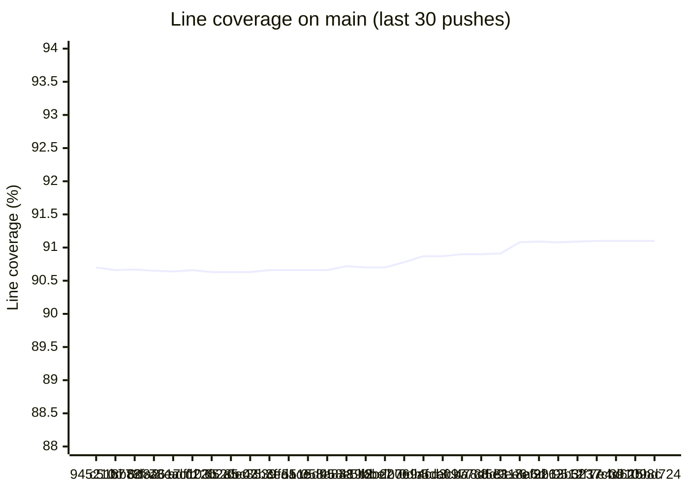

# Code coverage history

Line coverage of `src/eplugin-framework/addons/ePlugin` on `main`, recorded by the CI-PR workflow after every push. This branch is generated; do not edit it.

**91.10%** (11030 of 12108 lines) at [15bd724](https://github.com/enaweg/godot-epluginframework/commit/15bd724bedf34f9f33929ba566dc188b53f4e2c5), 2026-10-26.

| Date | Commit | Line coverage | Change |
|:--|:--|--:|--:|
| 2026-10-26 | [15bd724](https://github.com/enaweg/godot-epluginframework/commit/15bd724bedf34f9f33929ba566dc188b53f4e2c5) | 91.10% | +0.00 pp |
| 2026-10-26 | [391098c](https://github.com/enaweg/godot-epluginframework/commit/391098c5badca5f2ce7155f5332658f7fd268380) | 91.10% | +0.00 pp |
| 2026-10-25 | [7e4d62b](https://github.com/enaweg/godot-epluginframework/commit/7e4d62b8e2a38bbecd4d4a1fe3dc8c3d395e6174) | 91.10% | +0.00 pp |
| 2026-10-25 | [5237cbd](https://github.com/enaweg/godot-epluginframework/commit/5237cbdf3003cc691fe9f4f1a9111186558155b1) | 91.10% | +0.01 pp |
| 2026-10-25 | [9512f17](https://github.com/enaweg/godot-epluginframework/commit/9512f175db8865f82d1940c19773c986f9dcf6cc) | 91.09% | +0.01 pp |
| 2026-10-25 | [9b13b3f](https://github.com/enaweg/godot-epluginframework/commit/9b13b3f4aaad822e3b339ff52819b9ed91425a76) | 91.08% | -0.01 pp |
| 2026-10-25 | [7ef2262](https://github.com/enaweg/godot-epluginframework/commit/7ef226280f62784755211f9972b59c38708e3ac6) | 91.09% | +0.01 pp |
| 2026-10-25 | [8118a6d](https://github.com/enaweg/godot-epluginframework/commit/8118a6d95c68d3b19931aafc7b631c30bb0d5d0f) | 91.08% | +0.17 pp |
| 2026-10-25 | [3dd9ee6](https://github.com/enaweg/godot-epluginframework/commit/3dd9ee61da6f71bbb0fbd3c0895e16a2f5c8ac67) | 90.91% | +0.01 pp |
| 2026-10-25 | [478d5e3](https://github.com/enaweg/godot-epluginframework/commit/478d5e3f12b8d6f62517d80c1faaa450703c4f27) | 90.90% | +0.00 pp |
| 2026-10-25 | [e0977c8](https://github.com/enaweg/godot-epluginframework/commit/e0977c81c789ea6eb2e5b35853e60d9e3a817db4) | 90.90% | +0.03 pp |
| 2026-10-25 | [acd3cba](https://github.com/enaweg/godot-epluginframework/commit/acd3cba0c55856981d6f8a3a8ae033054487120d) | 90.87% | +0.00 pp |
| 2026-10-25 | [0db5daf](https://github.com/enaweg/godot-epluginframework/commit/0db5dafb8c32b3d416d7a6202ccab37b22d98a52) | 90.87% | +0.09 pp |
| 2026-10-25 | [2b0e94f](https://github.com/enaweg/godot-epluginframework/commit/2b0e94f888db40a19927f2d1e8e0b7f7962dedf4) | 90.78% | +0.08 pp |
| 2026-10-25 | [f8bd276](https://github.com/enaweg/godot-epluginframework/commit/f8bd2763202c939e23a41cbc61d1dcaa39fcf312) | 90.70% | +0.00 pp |
| 2026-10-25 | [419bbe7](https://github.com/enaweg/godot-epluginframework/commit/419bbe77c30fb0ae4558e7447841ce7fce2bb781) | 90.70% | -0.02 pp |
| 2026-10-24 | [458e5b2](https://github.com/enaweg/godot-epluginframework/commit/458e5b24696bfa78295d5c1b44e5e93efabf9fa7) | 90.72% | +0.06 pp |
| 2026-10-24 | [058a838](https://github.com/enaweg/godot-epluginframework/commit/058a838a4d69344f49bb378b612bfa11e3899499) | 90.66% | +0.00 pp |
| 2026-10-24 | [5515d95](https://github.com/enaweg/godot-epluginframework/commit/5515d9505b71cde85498a00b38558c94a0e1d9f8) | 90.66% | +0.00 pp |
| 2026-10-24 | [cffdace](https://github.com/enaweg/godot-epluginframework/commit/cffdace7e70b0bfb52190f4fb8c9ec369e95f251) | 90.66% | +0.00 pp |
| 2026-10-24 | [43b3ea1](https://github.com/enaweg/godot-epluginframework/commit/43b3ea1d80695ca3c8d615652e3d9b02ddf2e15c) | 90.66% | +0.03 pp |
| 2026-10-24 | [8bc3539](https://github.com/enaweg/godot-epluginframework/commit/8bc353965fcd43bbeea1a15dc83cfc23a67a2cfc) | 90.63% | +0.00 pp |
| 2026-10-24 | [6520e07](https://github.com/enaweg/godot-epluginframework/commit/6520e077a59f7e7264eee744c627dc0a2728a667) | 90.63% | +0.00 pp |
| 2026-10-24 | [d2202a5](https://github.com/enaweg/godot-epluginframework/commit/d2202a557392452cb49b9b2cb0f70df51dd20dc9) | 90.63% | -0.03 pp |
| 2026-10-24 | [adf103b](https://github.com/enaweg/godot-epluginframework/commit/adf103bf179501f0ce72cd49ced89d71a2ff09b5) | 90.66% | +0.02 pp |
| 2026-10-24 | [78eacfd](https://github.com/enaweg/godot-epluginframework/commit/78eacfd3e8001654bcd67ab813d2e99f280e1aa0) | 90.64% | -0.01 pp |
| 2026-10-24 | [6d8a617](https://github.com/enaweg/godot-epluginframework/commit/6d8a61774cf869b8adb817da34b5d71b38235383) | 90.65% | -0.02 pp |
| 2026-10-24 | [b778fa2](https://github.com/enaweg/godot-epluginframework/commit/b778fa2146c4db3ef67a3bd9785348588e4c8a5c) | 90.67% | +0.01 pp |
| 2026-10-24 | [c518b82](https://github.com/enaweg/godot-epluginframework/commit/c518b82f4053cb7cab94e11d9f56a5b0e5a30e07) | 90.66% | -0.04 pp |
| 2026-10-24 | [945210c](https://github.com/enaweg/godot-epluginframework/commit/945210c3d23bee999d2db978affa897d6767945d) | 90.70% | +0.00 pp |

All measurements: [history.csv](history.csv).

Files at 15bd724 (130)

| File | Line coverage | Covered lines |
|:--|--:|--:|
| `Internal/ProjectSettingsDialog.cs` | 9.4% | 5 of 53 |
| `EPlugin.cs` | 33.3% | 4 of 12 |
| `Internal/AssemblyUnloadCleanup.cs` | 38.9% | 7 of 18 |
| `Internal/EditorHost.cs` | 59.3% | 51 of 86 |
| `Internal/Manager/EditorWindows.cs` | 61.8% | 42 of 68 |
| `EPluginPlugin.cs` | 63.9% | 175 of 274 |
| `Internal/EGlobal.UpdateApply.cs` | 64.2% | 181 of 282 |
| `Internal/Manager/GeneralSettingsTab.cs` | 74.7% | 56 of 75 |
| `Internal/EGlobal.Transitions.cs` | 75.8% | 100 of 132 |
| `Internal/Manager/EPluginManagerDialog.Operations.cs` | 75.8% | 100 of 132 |
| `Internal/Manager/EPluginManagerDialog.Versions.cs` | 76.4% | 81 of 106 |
| `Logging/GodotConsoleLogger.cs` | 76.7% | 33 of 43 |
| `Internal/EGlobal.UpdateWorkflow.cs` | 77.8% | 7 of 9 |
| `Internal/ProgressSession.cs` | 78.8% | 171 of 217 |
| `Internal/EGlobal.LocalSources.cs` | 79.3% | 46 of 58 |
| `Internal/Manager/UpdateReviewDialog.cs` | 82.1% | 78 of 95 |
| `Internal/EGlobal.AddonInstall.cs` | 82.4% | 28 of 34 |
| `Internal/ActivationProgress.cs` | 82.7% | 253 of 306 |
| `Internal/Manager/EPluginManagerDialog.Updates.cs` | 82.8% | 53 of 64 |
| `Internal/PluginTypes.cs` | 83.3% | 15 of 18 |
| `Internal/EGlobal.Updates.cs` | 83.5% | 132 of 158 |
| `Internal/Manager/AttentionDialog.cs` | 84.6% | 99 of 117 |
| `Internal/Manager/EPluginManagerDialog.Zip.cs` | 85.2% | 75 of 88 |
| `Internal/Manager/UpdateFailureDialog.cs` | 85.5% | 53 of 62 |
| `Internal/AssemblyReload.cs` | 85.7% | 24 of 28 |
| `Internal/Manager/WelcomeDialog.cs` | 85.7% | 54 of 63 |
| `Internal/Update/AddonInstaller.cs` | 85.9% | 61 of 71 |
| `Internal/EGlobal.cs` | 86.6% | 264 of 305 |
| `Internal/Manager/UpdateSourcesTab.cs` | 87.2% | 253 of 290 |
| `EditorPluginExtensions.cs` | 87.3% | 62 of 71 |
| `Internal/Welcomes/PluginWelcome.cs` | 87.9% | 29 of 33 |
| `Internal/Manager/SettingsDialog.cs` | 88.0% | 44 of 50 |
| `Internal/Kinds/GDExtensionRules.cs` | 88.2% | 30 of 34 |
| `Internal/Manager/EPluginManagerDialog.cs` | 89.2% | 329 of 369 |
| `Internal/EGlobal.RecipeOperations.cs` | 89.5% | 111 of 124 |
| `Internal/Kinds/NativeExtensionStatus.cs` | 89.7% | 26 of 29 |
| `Internal/EGlobal.MissingPlugins.cs` | 90.6% | 29 of 32 |
| `Internal/EGlobal.PlainPlugins.cs` | 90.9% | 130 of 143 |
| `Internal/Licenses/PluginLicense.cs` | 91.1% | 41 of 45 |
| `Internal/Update/AddonSwap.cs` | 91.2% | 114 of 125 |
| `Internal/EGlobal.PluginManager.cs` | 91.5% | 75 of 82 |
| `Internal/Manager/LicenseDialog.cs` | 92.0% | 150 of 163 |
| `Internal/Update/UpdateApplier.cs` | 92.2% | 427 of 463 |
| `Internal/EGlobal.Retry.cs` | 92.3% | 144 of 156 |
| `Internal/Update/InterimBridge.cs` | 93.2% | 41 of 44 |
| `Internal/EGlobal.Welcomes.cs` | 93.2% | 69 of 74 |
| `Internal/EGlobal.Activation.cs` | 93.5% | 290 of 310 |
| `Internal/Manager/ManagerReopenMarker.cs` | 94.1% | 16 of 17 |
| `Internal/Update/PluginCode.cs` | 94.7% | 18 of 19 |
| `Internal/Manager/EditorIcons.cs` | 94.8% | 55 of 58 |
| `Internal/Dotnet/ProjectReferences.cs` | 95.0% | 38 of 40 |
| `Internal/Update/LocalIndexCache.cs` | 96.0% | 24 of 25 |
| `Internal/Update/PackageFetcher.cs` | 96.0% | 96 of 100 |
| `Internal/Kinds/PluginKinds.cs` | 96.2% | 50 of 52 |
| `Internal/Update/RecipeSnapshot.cs` | 96.2% | 25 of 26 |
| `Internal/EGlobal.Deactivation.cs` | 96.3% | 130 of 135 |
| `Internal/Kinds/GDExtensionPluginWorkflow.cs` | 96.3% | 78 of 81 |
| `Internal/Update/BuildDiagnostics.cs` | 96.3% | 52 of 54 |
| `Internal/EGlobal.Licenses.cs` | 96.4% | 243 of 252 |
| `Internal/EGlobal.OptionalDependencies.cs` | 96.4% | 108 of 112 |
| `Internal/Update/UpdateService.cs` | 96.5% | 111 of 115 |
| `Internal/Manager/UpdateFlow.cs` | 96.5% | 195 of 202 |
| `Internal/Update/SafeZipExtractor.cs` | 96.6% | 86 of 89 |
| `Internal/Update/UpdateModels.cs` | 96.8% | 60 of 62 |
| `Internal/Dotnet/NugetConfigManager.cs` | 97.0% | 256 of 264 |
| `Internal/Dotnet/ExecuteCliBase.cs` | 97.1% | 34 of 35 |
| `Internal/PlainPluginObserver.cs` | 97.2% | 69 of 71 |
| `Internal/Update/LocalPackageIndex.cs` | 97.4% | 74 of 76 |
| `Internal/Update/UpdateRecovery.cs` | 97.4% | 151 of 155 |
| `Internal/PluginStateStore.cs` | 97.4% | 456 of 468 |
| `Internal/Manager/PluginAttention.cs` | 97.5% | 79 of 81 |
| `Internal/Update/UpdateStateStore.cs` | 97.7% | 43 of 44 |
| `Internal/Manager/ZipInstall.cs` | 97.8% | 44 of 45 |
| `Internal/Update/GitSource.cs` | 98.0% | 194 of 198 |
| `Internal/ShowHideHelper.cs` | 98.0% | 98 of 100 |
| `Internal/Update/RecipeReconciler.cs` | 98.0% | 50 of 51 |
| `Internal/Dotnet/BuildOutputGuard.cs` | 98.1% | 52 of 53 |
| `Internal/Manager/PluginManagerViewModel.cs` | 98.2% | 276 of 281 |
| `Internal/Update/AddonPackageValidator.cs` | 98.6% | 136 of 138 |
| `Internal/EGlobal.UpdateRecipes.cs` | 98.9% | 187 of 189 |
| `Internal/Update/ReleaseSources.cs` | 99.0% | 189 of 191 |
| `Internal/Update/UpdateHttp.cs` | 99.0% | 95 of 96 |
| `Internal/Update/PackageFiles.cs` | 99.0% | 104 of 105 |
| `Internal/Kinds/GDExtensionConfig.cs` | 99.4% | 165 of 166 |
| `EEditorPluginMetadata.cs` | 100.0% | 4 of 4 |
| `IEEditorPluginExtensions.cs` | 100.0% | 15 of 15 |
| `Internal/Dotnet/DotnetCli10.cs` | 100.0% | 78 of 78 |
| `Internal/Dotnet/DotnetCli9.cs` | 100.0% | 78 of 78 |
| `Internal/Dotnet/DotnetCliBase.cs` | 100.0% | 70 of 70 |
| `Internal/Dotnet/DotnetVersionManager.cs` | 100.0% | 41 of 41 |
| `Internal/Dotnet/ICheckedDotnetCli.cs` | 100.0% | 1 of 1 |
| `Internal/Dotnet/PluginsOnlyBuild.cs` | 100.0% | 32 of 32 |
| `Internal/EEditorPluginBuilder.cs` | 100.0% | 69 of 69 |
| `Internal/EEditorPluginRecipe.cs` | 100.0% | 13 of 13 |
| `Internal/EEditorPluginSubRecipeBuilder.cs` | 100.0% | 35 of 35 |
| `Internal/EGlobal.ExtensionAddons.cs` | 100.0% | 19 of 19 |
| `Internal/EGlobal.UpdateSites.cs` | 100.0% | 19 of 19 |
| `Internal/EPluginProgress.cs` | 100.0% | 1 of 1 |
| `Internal/Kinds/CSharpPluginWorkflow.cs` | 100.0% | 4 of 4 |
| `Internal/Kinds/EPluginWorkflow.cs` | 100.0% | 14 of 14 |
| `Internal/Kinds/FrameworkPluginWorkflow.cs` | 100.0% | 7 of 7 |
| `Internal/Kinds/GDScriptPluginWorkflow.cs` | 100.0% | 4 of 4 |
| `Internal/Kinds/PluginKindWorkflow.cs` | 100.0% | 13 of 13 |
| `Internal/Kinds/UnknownPluginWorkflow.cs` | 100.0% | 4 of 4 |
| `Internal/Licenses/LicenseReview.cs` | 100.0% | 47 of 47 |
| `Internal/Licenses/LicenseSettings.cs` | 100.0% | 9 of 9 |
| `Internal/LoggingSettings.cs` | 100.0% | 9 of 9 |
| `Internal/Manager/AboutTab.cs` | 100.0% | 58 of 58 |
| `Internal/Manager/EditorSignalConnections.cs` | 100.0% | 12 of 12 |
| `Internal/Manager/ObservedTask.cs` | 100.0% | 4 of 4 |
| `Internal/Manager/PluginCatalog.cs` | 100.0% | 11 of 11 |
| `Internal/Manager/TextColors.cs` | 100.0% | 11 of 11 |
| `Internal/Manager/UpdateReview.cs` | 100.0% | 71 of 71 |
| `Internal/PluginContext.cs` | 100.0% | 14 of 14 |
| `Internal/PluginToggles.cs` | 100.0% | 13 of 13 |
| `Internal/RecipeEntries.cs` | 100.0% | 69 of 69 |
| `Internal/Update/AddonArchive.cs` | 100.0% | 48 of 48 |
| `Internal/Update/KnownPlugins.Data.cs` | 100.0% | 1043 of 1043 |
| `Internal/Update/KnownPlugins.cs` | 100.0% | 6 of 6 |
| `Internal/Update/LocalSourceSettings.cs` | 100.0% | 46 of 46 |
| `Internal/Update/SemVer.cs` | 100.0% | 46 of 46 |
| `Internal/Update/UidMap.cs` | 100.0% | 10 of 10 |
| `Internal/Update/UpdateGroups.cs` | 100.0% | 20 of 20 |
| `Internal/Update/UpdateJournal.cs` | 100.0% | 68 of 68 |
| `Internal/Update/UpdateSettings.cs` | 100.0% | 18 of 18 |
| `Internal/Update/UpdateSiteSettings.cs` | 100.0% | 50 of 50 |
| `Internal/VersionConstraint.cs` | 100.0% | 25 of 25 |
| `Internal/Welcomes/WelcomeSettings.cs` | 100.0% | 9 of 9 |
| `Logging/GenericLoggerFactory.cs` | 100.0% | 7 of 7 |
| `Logging/NullLogger.cs` | 100.0% | 6 of 6 |

