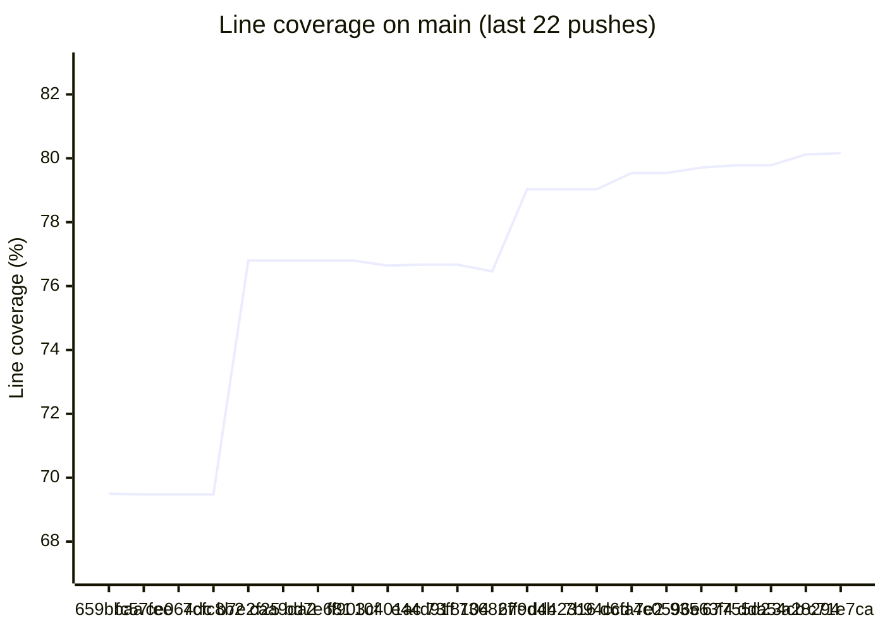

# Code coverage history

Line coverage of `src/eplugin-framework/addons/ePlugin` on `main`, recorded by the CI-PR workflow after every push. This branch is generated; do not edit it.

**80.16%** (8035 of 10024 lines) at [c71e7ca](https://github.com/enaweg/godot-epluginframework/commit/c71e7caf68d2df5741f61283d47ee68f1aacb6f7), 2026-10-20.

| Date | Commit | Line coverage | Change |
|:--|:--|--:|--:|
| 2026-10-20 | [c71e7ca](https://github.com/enaweg/godot-epluginframework/commit/c71e7caf68d2df5741f61283d47ee68f1aacb6f7) | 80.16% | +0.04 pp |
| 2026-10-20 | [3a28294](https://github.com/enaweg/godot-epluginframework/commit/3a28294b5aa43b9e7e8df8146a9c415d26b917f3) | 80.12% | +0.34 pp |
| 2026-10-20 | [dda54cb](https://github.com/enaweg/godot-epluginframework/commit/dda54cbc1e267058c4b9cdd58984c55d2bf5c38e) | 79.78% | +0.00 pp |
| 2026-10-17 | [67755d2](https://github.com/enaweg/godot-epluginframework/commit/67755d2720b48fb97fc589b1fff88d94ad56925c) | 79.78% | +0.07 pp |
| 2026-10-17 | [93563f4](https://github.com/enaweg/godot-epluginframework/commit/93563f44708413d616cde9989497630a71c069b0) | 79.71% | +0.17 pp |
| 2026-10-17 | [4c0596e](https://github.com/enaweg/godot-epluginframework/commit/4c0596e4b1ad1201ecc0253c9e74554ab7409529) | 79.54% | +0.00 pp |
| 2026-10-17 | [d6fa7e2](https://github.com/enaweg/godot-epluginframework/commit/d6fa7e2bf3286e8cc0eb8b5330d6bb917aef2c8f) | 79.54% | +0.51 pp |
| 2026-10-17 | [7b94ccd](https://github.com/enaweg/godot-epluginframework/commit/7b94ccdc2ce811f3293f97e3c21b77515fffcf2c) | 79.03% | +0.00 pp |
| 2026-10-17 | [dd42316](https://github.com/enaweg/godot-epluginframework/commit/dd4231688782e8151d5296688ec0313a038db1d7) | 79.03% | +0.00 pp |
| 2026-10-17 | [6ff9d4b](https://github.com/enaweg/godot-epluginframework/commit/6ff9d4b729e3bfaacd8544a36ffb26408e059a0c) | 79.03% | +2.57 pp |
| 2026-10-17 | [736827c](https://github.com/enaweg/godot-epluginframework/commit/736827c1a81fe9a1d0974f7b4b69d82be89cd3d6) | 76.46% | -0.21 pp |
| 2026-10-17 | [73f8104](https://github.com/enaweg/godot-epluginframework/commit/73f8104ae916ade392b7d2fffa7cddf1fd75b81c) | 76.67% | +0.00 pp |
| 2026-10-16 | [e44d91f](https://github.com/enaweg/godot-epluginframework/commit/e44d91f69afe69c46752ee3db6c85e90fa6c8822) | 76.67% | +0.03 pp |
| 2026-10-16 | [10401ac](https://github.com/enaweg/godot-epluginframework/commit/10401ac5c5d5370fabf3b0c53da57356d306e0e3) | 76.64% | -0.16 pp |
| 2026-10-16 | [ff903cf](https://github.com/enaweg/godot-epluginframework/commit/ff903cf12369521deb3cd90778bd1d3407543cbe) | 76.80% | +0.00 pp |
| 2026-10-16 | [bd7e681](https://github.com/enaweg/godot-epluginframework/commit/bd7e6810f7f41310d2483a1f6a4fc1df2366ea25) | 76.80% | +0.00 pp |
| 2026-10-15 | [caa9da2](https://github.com/enaweg/godot-epluginframework/commit/caa9da2162fca30674b6017e64232cd30cbc9554) | 76.80% | +0.00 pp |
| 2026-10-14 | [b7e2f25](https://github.com/enaweg/godot-epluginframework/commit/b7e2f25c6bde4f431377ff0e97157f6ef01d0a92) | 76.80% | +7.32 pp |
| 2026-10-14 | [7cfc8b2](https://github.com/enaweg/godot-epluginframework/commit/7cfc8b29f72977d4323e61f7ffb55d0aaa2dc2dd) | 69.48% | +0.00 pp |
| 2026-10-14 | [ce064dc](https://github.com/enaweg/godot-epluginframework/commit/ce064dcd5bc338704d9468a1fb171bd364e3c076) | 69.48% | +0.00 pp |
| 2026-10-14 | [fc57fee](https://github.com/enaweg/godot-epluginframework/commit/fc57fee06cb05235d5cafd80d663e2e5797f8ed6) | 69.48% | -0.02 pp |
| 2026-10-14 | [659bbaa](https://github.com/enaweg/godot-epluginframework/commit/659bbaa6769ba1db6a0da1e7bee266b2158f5e74) | 69.50% |  |

All measurements: [history.csv](history.csv).

Files at c71e7ca (109)

| File | Line coverage | Covered lines |
|:--|--:|--:|
| `Internal/EGlobal.UpdateWorkflow.cs` | 0.0% | 0 of 7 |
| `Internal/Manager/UpdateFailureDialog.cs` | 0.0% | 0 of 57 |
| `Internal/Manager/LicenseDialog.cs` | 7.5% | 12 of 161 |
| `Internal/Manager/UpdateSitesDialog.cs` | 8.2% | 16 of 194 |
| `Internal/Manager/EPluginManagerDialog.cs` | 8.7% | 53 of 607 |
| `Internal/ProjectSettingsDialog.cs` | 9.4% | 5 of 53 |
| `Internal/Manager/LocalSourcesDialog.cs` | 18.0% | 16 of 89 |
| `Internal/Manager/WelcomeDialog.cs` | 18.0% | 11 of 61 |
| `Internal/Kinds/CSharpPluginWorkflow.cs` | 25.0% | 1 of 4 |
| `Internal/Manager/EditorWindows.cs` | 33.3% | 18 of 54 |
| `Internal/EGlobal.UpdateApply.cs` | 37.8% | 101 of 267 |
| `Internal/AssemblyUnloadCleanup.cs` | 38.9% | 7 of 18 |
| `Internal/Manager/AboutDialog.cs` | 40.4% | 19 of 47 |
| `EPlugin.cs` | 44.4% | 4 of 9 |
| `Internal/EGlobal.UpdateSites.cs` | 47.4% | 9 of 19 |
| `Internal/Kinds/GDScriptPluginWorkflow.cs` | 50.0% | 2 of 4 |
| `Internal/EGlobal.LocalSources.cs` | 54.4% | 31 of 57 |
| `EPluginPlugin.cs` | 62.8% | 167 of 266 |
| `Internal/Manager/EditorIcons.cs` | 68.2% | 30 of 44 |
| `Internal/EditorHost.cs` | 69.4% | 34 of 49 |
| `Internal/Kinds/UnknownPluginWorkflow.cs` | 75.0% | 3 of 4 |
| `Internal/EGlobal.Updates.cs` | 75.7% | 87 of 115 |
| `Logging/GodotConsoleLogger.cs` | 76.7% | 33 of 43 |
| `Internal/ProgressSession.cs` | 81.4% | 153 of 188 |
| `Internal/ActivationProgress.cs` | 82.5% | 241 of 292 |
| `Internal/PluginTypes.cs` | 83.3% | 15 of 18 |
| `Internal/EGlobal.RecipeOperations.cs` | 83.8% | 62 of 74 |
| `EditorPluginExtensions.cs` | 85.2% | 52 of 61 |
| `Internal/AssemblyReload.cs` | 85.7% | 24 of 28 |
| `Internal/Kinds/FrameworkPluginWorkflow.cs` | 85.7% | 6 of 7 |
| `Internal/Kinds/GDExtensionRules.cs` | 86.1% | 31 of 36 |
| `Internal/EGlobal.PlainPlugins.cs` | 87.6% | 127 of 145 |
| `Internal/EGlobal.cs` | 87.6% | 886 of 1011 |
| `Internal/Welcomes/PluginWelcome.cs` | 87.9% | 29 of 33 |
| `Internal/Update/AddonSwap.cs` | 89.3% | 92 of 103 |
| `Internal/Kinds/NativeExtensionStatus.cs` | 89.7% | 26 of 29 |
| `Internal/Licenses/PluginLicense.cs` | 91.1% | 41 of 45 |
| `Internal/EGlobal.PluginManager.cs` | 91.2% | 73 of 80 |
| `Internal/EEditorPluginBuilder.cs` | 91.3% | 63 of 69 |
| `Internal/Kinds/EPluginWorkflow.cs` | 92.9% | 13 of 14 |
| `Internal/Update/UpdateApplier.cs` | 92.9% | 394 of 424 |
| `Internal/Update/InterimBridge.cs` | 93.2% | 41 of 44 |
| `Internal/EGlobal.Welcomes.cs` | 93.3% | 70 of 75 |
| `Internal/Update/UpdateService.cs` | 93.6% | 88 of 94 |
| `Internal/Kinds/GDExtensionPluginWorkflow.cs` | 93.8% | 76 of 81 |
| `Internal/Manager/ManagerReopenMarker.cs` | 94.1% | 16 of 17 |
| `Internal/EEditorPluginSubRecipeBuilder.cs` | 94.3% | 33 of 35 |
| `Internal/Update/PluginCode.cs` | 94.7% | 18 of 19 |
| `Internal/Dotnet/DotnetCliBase.cs` | 94.9% | 56 of 59 |
| `Internal/Dotnet/ProjectReferences.cs` | 95.0% | 38 of 40 |
| `Internal/Update/LocalIndexCache.cs` | 96.0% | 24 of 25 |
| `Internal/Kinds/PluginKinds.cs` | 96.2% | 50 of 52 |
| `Internal/Update/RecipeSnapshot.cs` | 96.2% | 25 of 26 |
| `Internal/Update/BuildDiagnostics.cs` | 96.3% | 52 of 54 |
| `Internal/Update/SafeZipExtractor.cs` | 96.3% | 78 of 81 |
| `Internal/Manager/PluginManagerViewModel.cs` | 96.3% | 262 of 272 |
| `Internal/PlainPluginObserver.cs` | 97.1% | 67 of 69 |
| `Internal/Update/UpdateModels.cs` | 97.1% | 34 of 35 |
| `Internal/Update/UpdateRecovery.cs` | 97.3% | 143 of 147 |
| `Internal/ShowHideHelper.cs` | 97.3% | 72 of 74 |
| `Internal/Update/LocalPackageIndex.cs` | 97.4% | 74 of 76 |
| `Internal/Update/UpdateStateStore.cs` | 97.4% | 37 of 38 |
| `Internal/EGlobal.Licenses.cs` | 97.5% | 231 of 237 |
| `Internal/Manager/UpdateFlow.cs` | 98.0% | 144 of 147 |
| `Internal/Dotnet/BuildOutputGuard.cs` | 98.0% | 49 of 50 |
| `Internal/Dotnet/NugetConfigManager.cs` | 98.0% | 147 of 150 |
| `Internal/Update/RecipeReconciler.cs` | 98.0% | 50 of 51 |
| `Internal/Update/UpdateJournal.cs` | 98.4% | 60 of 61 |
| `Internal/EGlobal.UpdateRecipes.cs` | 98.4% | 184 of 187 |
| `Internal/Update/GitSource.cs` | 98.5% | 203 of 206 |
| `Internal/Update/UpdateHttp.cs` | 98.6% | 71 of 72 |
| `Internal/PluginStateStore.cs` | 98.8% | 412 of 417 |
| `Internal/Update/ReleaseSources.cs` | 99.0% | 101 of 102 |
| `Internal/Update/PackageFiles.cs` | 99.0% | 104 of 105 |
| `Internal/Update/AddonPackageValidator.cs` | 99.1% | 108 of 109 |
| `Internal/Kinds/GDExtensionConfig.cs` | 99.3% | 152 of 153 |
| `EEditorPluginMetadata.cs` | 100.0% | 4 of 4 |
| `IEEditorPluginExtensions.cs` | 100.0% | 15 of 15 |
| `Internal/Dotnet/DotnetCli10.cs` | 100.0% | 78 of 78 |
| `Internal/Dotnet/DotnetCli9.cs` | 100.0% | 78 of 78 |
| `Internal/Dotnet/DotnetVersionManager.cs` | 100.0% | 41 of 41 |
| `Internal/Dotnet/ExecuteCliBase.cs` | 100.0% | 33 of 33 |
| `Internal/Dotnet/ICheckedDotnetCli.cs` | 100.0% | 1 of 1 |
| `Internal/Dotnet/PluginsOnlyBuild.cs` | 100.0% | 31 of 31 |
| `Internal/EEditorPluginRecipe.cs` | 100.0% | 13 of 13 |
| `Internal/EGlobal.ExtensionAddons.cs` | 100.0% | 19 of 19 |
| `Internal/EPluginProgress.cs` | 100.0% | 1 of 1 |
| `Internal/Kinds/PluginKindWorkflow.cs` | 100.0% | 13 of 13 |
| `Internal/Licenses/LicenseReview.cs` | 100.0% | 47 of 47 |
| `Internal/Licenses/LicenseSettings.cs` | 100.0% | 9 of 9 |
| `Internal/LoggingSettings.cs` | 100.0% | 9 of 9 |
| `Internal/Manager/EditorSignalConnections.cs` | 100.0% | 12 of 12 |
| `Internal/Manager/ObservedTask.cs` | 100.0% | 4 of 4 |
| `Internal/Manager/PluginCatalog.cs` | 100.0% | 11 of 11 |
| `Internal/PluginContext.cs` | 100.0% | 14 of 14 |
| `Internal/PluginToggles.cs` | 100.0% | 13 of 13 |
| `Internal/RecipeEntries.cs` | 100.0% | 69 of 69 |
| `Internal/Update/KnownPlugins.Data.cs` | 100.0% | 878 of 878 |
| `Internal/Update/KnownPlugins.cs` | 100.0% | 6 of 6 |
| `Internal/Update/LocalSourceSettings.cs` | 100.0% | 46 of 46 |
| `Internal/Update/PackageFetcher.cs` | 100.0% | 61 of 61 |
| `Internal/Update/SemVer.cs` | 100.0% | 36 of 36 |
| `Internal/Update/UidMap.cs` | 100.0% | 10 of 10 |
| `Internal/Update/UpdateGroups.cs` | 100.0% | 20 of 20 |
| `Internal/Update/UpdateSettings.cs` | 100.0% | 18 of 18 |
| `Internal/Update/UpdateSiteSettings.cs` | 100.0% | 50 of 50 |
| `Internal/VersionConstraint.cs` | 100.0% | 25 of 25 |
| `Logging/GenericLoggerFactory.cs` | 100.0% | 7 of 7 |
| `Logging/NullLogger.cs` | 100.0% | 6 of 6 |

