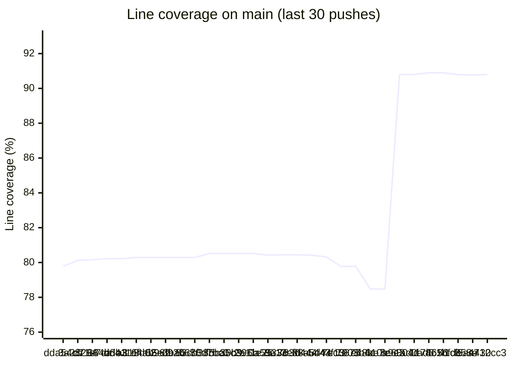

# Code coverage history

Line coverage of `src/eplugin-framework/addons/ePlugin` on `main`, recorded by the CI-PR workflow after every push. This branch is generated; do not edit it.

**90.80%** (10012 of 11026 lines) at [a712cc3](https://github.com/enaweg/godot-epluginframework/commit/a712cc373a8e556c56b9fb82b9098c7f73869378), 2026-10-23.

| Date | Commit | Line coverage | Change |
|:--|:--|--:|--:|
| 2026-10-23 | [a712cc3](https://github.com/enaweg/godot-epluginframework/commit/a712cc373a8e556c56b9fb82b9098c7f73869378) | 90.80% | +0.03 pp |
| 2026-10-23 | [f5a4430](https://github.com/enaweg/godot-epluginframework/commit/f5a44302f2d0196f6e9337915860c35ba84584ff) | 90.77% | -0.02 pp |
| 2026-10-23 | [41c358e](https://github.com/enaweg/godot-epluginframework/commit/41c358e029919210bb88935f765418bc8c04711a) | 90.79% | -0.11 pp |
| 2026-10-23 | [4c1bfde](https://github.com/enaweg/godot-epluginframework/commit/4c1bfde2252200ef1f7e8575df3d78b1e84f9543) | 90.90% | +0.00 pp |
| 2026-10-23 | [1178656](https://github.com/enaweg/godot-epluginframework/commit/11786563a447ec0ec9abdc68fe62a9e5d01d7ae3) | 90.90% | +0.10 pp |
| 2026-10-22 | [1ad0ad5](https://github.com/enaweg/godot-epluginframework/commit/1ad0ad55f4194abf44c7e0f1466a3eb1022975cc) | 90.80% | +0.00 pp |
| 2026-10-22 | [8c6304d](https://github.com/enaweg/godot-epluginframework/commit/8c6304d882e2ede10338bc884b276796b73dce24) | 90.80% | +12.32 pp |
| 2026-10-22 | [610a9e3](https://github.com/enaweg/godot-epluginframework/commit/610a9e3b90a1e240f5d542c80f25eead73abab52) | 78.48% | +0.00 pp |
| 2026-10-22 | [e48be7e](https://github.com/enaweg/godot-epluginframework/commit/e48be7e3d631eb195bf46923b24b78e957488089) | 78.48% | -1.31 pp |
| 2026-10-22 | [7903b4c](https://github.com/enaweg/godot-epluginframework/commit/7903b4c2b162e66b7d2acfb0a5935deec21e51c9) | 79.79% | +0.02 pp |
| 2026-10-22 | [7ec5675](https://github.com/enaweg/godot-epluginframework/commit/7ec56757503242eb87f1f2c03009b0c3907814c9) | 79.77% | -0.55 pp |
| 2026-10-22 | [5443f13](https://github.com/enaweg/godot-epluginframework/commit/5443f1344f6aeaaadcd21a194c48138a9178c491) | 80.32% | -0.10 pp |
| 2026-10-22 | [88a5d44](https://github.com/enaweg/godot-epluginframework/commit/88a5d445577c347ec6852e5d56d073bca25576b2) | 80.42% | -0.02 pp |
| 2026-10-22 | [7836444](https://github.com/enaweg/godot-epluginframework/commit/78364449dc352a9adc592128ba6ee7d03f276e01) | 80.44% | +0.00 pp |
| 2026-10-21 | [8a13efd](https://github.com/enaweg/godot-epluginframework/commit/8a13efd56794128395dab9ad90d5be74515b8486) | 80.44% | +0.02 pp |
| 2026-10-21 | [0a5933c](https://github.com/enaweg/godot-epluginframework/commit/0a5933c360c6362386702df4974013e4548bf0d3) | 80.42% | -0.10 pp |
| 2026-10-21 | [2a11e25](https://github.com/enaweg/godot-epluginframework/commit/2a11e25a6952521a00dd480fa036cc71894075ee) | 80.52% | +0.00 pp |
| 2026-10-21 | [a5c396b](https://github.com/enaweg/godot-epluginframework/commit/a5c396be648355c194c522cd84a3a41d5c28e3bc) | 80.52% | +0.00 pp |
| 2026-10-21 | [f5b30b9](https://github.com/enaweg/godot-epluginframework/commit/f5b30b91836492bc5e850a7fa58820e42e102df2) | 80.52% | +0.00 pp |
| 2026-10-21 | [88d7bc0](https://github.com/enaweg/godot-epluginframework/commit/88d7bc0ed0732086375837fd11e03983ca497b8c) | 80.52% | +0.23 pp |
| 2026-10-21 | [63cb38b](https://github.com/enaweg/godot-epluginframework/commit/63cb38b8e6aab9adad1128087cd0b17b50964dc2) | 80.29% | +0.00 pp |
| 2026-10-21 | [d92667f](https://github.com/enaweg/godot-epluginframework/commit/d92667faa7a061604c97d8c375063540482ab049) | 80.29% | +0.00 pp |
| 2026-10-21 | [56e3bab](https://github.com/enaweg/godot-epluginframework/commit/56e3bab1ca0e2d2a67143d4485f8a1e6d1ce9f3a) | 80.29% | +0.00 pp |
| 2026-10-20 | [e4ab969](https://github.com/enaweg/godot-epluginframework/commit/e4ab969c07560a8a9a57ac3eb5c6f298dc7b38d5) | 80.29% | +0.00 pp |
| 2026-10-20 | [a313d02](https://github.com/enaweg/godot-epluginframework/commit/a313d02449633cff9b165c5577f3bb9bdda3e507) | 80.29% | +0.07 pp |
| 2026-10-20 | [d64116f](https://github.com/enaweg/godot-epluginframework/commit/d64116fa3ba1059566dc786edd418299095281d7) | 80.22% | +0.00 pp |
| 2026-10-20 | [684bdb3](https://github.com/enaweg/godot-epluginframework/commit/684bdb3cb8ca2315426973c5da6f15de9bc114fb) | 80.22% | +0.06 pp |
| 2026-10-20 | [c71e7ca](https://github.com/enaweg/godot-epluginframework/commit/c71e7caf68d2df5741f61283d47ee68f1aacb6f7) | 80.16% | +0.04 pp |
| 2026-10-20 | [3a28294](https://github.com/enaweg/godot-epluginframework/commit/3a28294b5aa43b9e7e8df8146a9c415d26b917f3) | 80.12% | +0.34 pp |
| 2026-10-20 | [dda54cb](https://github.com/enaweg/godot-epluginframework/commit/dda54cbc1e267058c4b9cdd58984c55d2bf5c38e) | 79.78% | +0.00 pp |

All measurements: [history.csv](history.csv).

Files at a712cc3 (115)

| File | Line coverage | Covered lines |
|:--|--:|--:|
| `Internal/ProjectSettingsDialog.cs` | 9.4% | 5 of 53 |
| `Internal/EGlobal.UpdateWorkflow.cs` | 14.3% | 1 of 7 |
| `EPlugin.cs` | 33.3% | 4 of 12 |
| `Internal/AssemblyUnloadCleanup.cs` | 38.9% | 7 of 18 |
| `Internal/EditorHost.cs` | 54.5% | 36 of 66 |
| `Internal/EGlobal.UpdateApply.cs` | 61.0% | 169 of 277 |
| `EPluginPlugin.cs` | 63.9% | 175 of 274 |
| `Internal/Manager/EditorWindows.cs` | 64.1% | 41 of 64 |
| `Internal/Manager/UpdateReviewDialog.cs` | 74.2% | 69 of 93 |
| `Internal/Manager/GeneralSettingsTab.cs` | 74.3% | 55 of 74 |
| `Logging/GodotConsoleLogger.cs` | 76.7% | 33 of 43 |
| `Internal/EGlobal.Updates.cs` | 78.6% | 92 of 117 |
| `Internal/EGlobal.LocalSources.cs` | 78.9% | 45 of 57 |
| `Internal/ProgressSession.cs` | 80.1% | 157 of 196 |
| `Internal/Manager/EPluginManagerDialog.cs` | 81.6% | 515 of 631 |
| `Internal/ActivationProgress.cs` | 82.5% | 245 of 297 |
| `Internal/PluginTypes.cs` | 83.3% | 15 of 18 |
| `Internal/Manager/AttentionDialog.cs` | 84.6% | 99 of 117 |
| `Internal/Manager/UpdateFailureDialog.cs` | 85.0% | 51 of 60 |
| `EditorPluginExtensions.cs` | 85.2% | 52 of 61 |
| `Internal/Manager/WelcomeDialog.cs` | 85.2% | 52 of 61 |
| `Internal/AssemblyReload.cs` | 85.7% | 24 of 28 |
| `Internal/Manager/SettingsDialog.cs` | 85.7% | 42 of 49 |
| `Internal/EGlobal.RecipeOperations.cs` | 86.5% | 83 of 96 |
| `Internal/Welcomes/PluginWelcome.cs` | 87.9% | 29 of 33 |
| `Internal/Kinds/GDExtensionRules.cs` | 88.2% | 30 of 34 |
| `Internal/EGlobal.PlainPlugins.cs` | 89.0% | 130 of 146 |
| `Internal/EGlobal.cs` | 89.3% | 966 of 1082 |
| `Internal/Kinds/NativeExtensionStatus.cs` | 89.7% | 26 of 29 |
| `Internal/Update/AddonSwap.cs` | 90.5% | 105 of 116 |
| `Internal/Licenses/PluginLicense.cs` | 91.1% | 41 of 45 |
| `Internal/EGlobal.PluginManager.cs` | 91.5% | 75 of 82 |
| `Internal/Manager/LicenseDialog.cs` | 91.9% | 148 of 161 |
| `Internal/Update/UpdateApplier.cs` | 92.6% | 401 of 433 |
| `Internal/Update/InterimBridge.cs` | 93.2% | 41 of 44 |
| `Internal/EGlobal.Welcomes.cs` | 93.3% | 70 of 75 |
| `Internal/Manager/ManagerReopenMarker.cs` | 94.1% | 16 of 17 |
| `Internal/Manager/UpdateSourcesTab.cs` | 94.3% | 266 of 282 |
| `Internal/Manager/EditorIcons.cs` | 94.5% | 52 of 55 |
| `Internal/Update/PluginCode.cs` | 94.7% | 18 of 19 |
| `Internal/Dotnet/ProjectReferences.cs` | 95.0% | 38 of 40 |
| `Internal/Update/LocalIndexCache.cs` | 96.0% | 24 of 25 |
| `Internal/Kinds/PluginKinds.cs` | 96.2% | 50 of 52 |
| `Internal/Update/RecipeSnapshot.cs` | 96.2% | 25 of 26 |
| `Internal/Kinds/GDExtensionPluginWorkflow.cs` | 96.3% | 78 of 81 |
| `Internal/Update/BuildDiagnostics.cs` | 96.3% | 52 of 54 |
| `Internal/Update/SafeZipExtractor.cs` | 96.3% | 78 of 81 |
| `Internal/Update/UpdateService.cs` | 96.3% | 105 of 109 |
| `Internal/Update/UpdateModels.cs` | 96.8% | 60 of 62 |
| `Internal/PlainPluginObserver.cs` | 97.1% | 67 of 69 |
| `Internal/Dotnet/ExecuteCliBase.cs` | 97.1% | 34 of 35 |
| `Internal/Update/UpdateRecovery.cs` | 97.3% | 145 of 149 |
| `Internal/Update/LocalPackageIndex.cs` | 97.4% | 74 of 76 |
| `Internal/EGlobal.Licenses.cs` | 97.5% | 231 of 237 |
| `Internal/Manager/PluginAttention.cs` | 97.5% | 79 of 81 |
| `Internal/ShowHideHelper.cs` | 97.6% | 82 of 84 |
| `Internal/Update/UpdateStateStore.cs` | 97.7% | 43 of 44 |
| `Internal/PluginStateStore.cs` | 97.8% | 439 of 449 |
| `Internal/Dotnet/BuildOutputGuard.cs` | 98.0% | 49 of 50 |
| `Internal/Update/RecipeReconciler.cs` | 98.0% | 50 of 51 |
| `Internal/Dotnet/NugetConfigManager.cs` | 98.1% | 153 of 156 |
| `Internal/Update/GitSource.cs` | 98.1% | 210 of 214 |
| `Internal/Manager/PluginManagerViewModel.cs` | 98.2% | 275 of 280 |
| `Internal/EGlobal.UpdateRecipes.cs` | 98.4% | 184 of 187 |
| `Internal/Update/ReleaseSources.cs` | 98.5% | 134 of 136 |
| `Internal/Update/UpdateHttp.cs` | 99.0% | 95 of 96 |
| `Internal/Update/PackageFiles.cs` | 99.0% | 104 of 105 |
| `Internal/Update/AddonPackageValidator.cs` | 99.1% | 113 of 114 |
| `Internal/Kinds/GDExtensionConfig.cs` | 99.4% | 153 of 154 |
| `EEditorPluginMetadata.cs` | 100.0% | 4 of 4 |
| `IEEditorPluginExtensions.cs` | 100.0% | 15 of 15 |
| `Internal/Dotnet/DotnetCli10.cs` | 100.0% | 78 of 78 |
| `Internal/Dotnet/DotnetCli9.cs` | 100.0% | 78 of 78 |
| `Internal/Dotnet/DotnetCliBase.cs` | 100.0% | 64 of 64 |
| `Internal/Dotnet/DotnetVersionManager.cs` | 100.0% | 41 of 41 |
| `Internal/Dotnet/ICheckedDotnetCli.cs` | 100.0% | 1 of 1 |
| `Internal/Dotnet/PluginsOnlyBuild.cs` | 100.0% | 32 of 32 |
| `Internal/EEditorPluginBuilder.cs` | 100.0% | 69 of 69 |
| `Internal/EEditorPluginRecipe.cs` | 100.0% | 13 of 13 |
| `Internal/EEditorPluginSubRecipeBuilder.cs` | 100.0% | 35 of 35 |
| `Internal/EGlobal.ExtensionAddons.cs` | 100.0% | 19 of 19 |
| `Internal/EGlobal.UpdateSites.cs` | 100.0% | 19 of 19 |
| `Internal/EPluginProgress.cs` | 100.0% | 1 of 1 |
| `Internal/Kinds/CSharpPluginWorkflow.cs` | 100.0% | 4 of 4 |
| `Internal/Kinds/EPluginWorkflow.cs` | 100.0% | 14 of 14 |
| `Internal/Kinds/FrameworkPluginWorkflow.cs` | 100.0% | 7 of 7 |
| `Internal/Kinds/GDScriptPluginWorkflow.cs` | 100.0% | 4 of 4 |
| `Internal/Kinds/PluginKindWorkflow.cs` | 100.0% | 13 of 13 |
| `Internal/Kinds/UnknownPluginWorkflow.cs` | 100.0% | 4 of 4 |
| `Internal/Licenses/LicenseReview.cs` | 100.0% | 47 of 47 |
| `Internal/Licenses/LicenseSettings.cs` | 100.0% | 9 of 9 |
| `Internal/LoggingSettings.cs` | 100.0% | 9 of 9 |
| `Internal/Manager/AboutTab.cs` | 100.0% | 58 of 58 |
| `Internal/Manager/EditorSignalConnections.cs` | 100.0% | 12 of 12 |
| `Internal/Manager/ObservedTask.cs` | 100.0% | 4 of 4 |
| `Internal/Manager/PluginCatalog.cs` | 100.0% | 11 of 11 |
| `Internal/Manager/UpdateFlow.cs` | 100.0% | 153 of 153 |
| `Internal/Manager/UpdateReview.cs` | 100.0% | 68 of 68 |
| `Internal/PluginContext.cs` | 100.0% | 14 of 14 |
| `Internal/PluginToggles.cs` | 100.0% | 13 of 13 |
| `Internal/RecipeEntries.cs` | 100.0% | 69 of 69 |
| `Internal/Update/KnownPlugins.Data.cs` | 100.0% | 962 of 962 |
| `Internal/Update/KnownPlugins.cs` | 100.0% | 6 of 6 |
| `Internal/Update/LocalSourceSettings.cs` | 100.0% | 46 of 46 |
| `Internal/Update/PackageFetcher.cs` | 100.0% | 61 of 61 |
| `Internal/Update/SemVer.cs` | 100.0% | 37 of 37 |
| `Internal/Update/UidMap.cs` | 100.0% | 10 of 10 |
| `Internal/Update/UpdateGroups.cs` | 100.0% | 20 of 20 |
| `Internal/Update/UpdateJournal.cs` | 100.0% | 68 of 68 |
| `Internal/Update/UpdateSettings.cs` | 100.0% | 18 of 18 |
| `Internal/Update/UpdateSiteSettings.cs` | 100.0% | 50 of 50 |
| `Internal/VersionConstraint.cs` | 100.0% | 25 of 25 |
| `Internal/Welcomes/WelcomeSettings.cs` | 100.0% | 9 of 9 |
| `Logging/GenericLoggerFactory.cs` | 100.0% | 7 of 7 |
| `Logging/NullLogger.cs` | 100.0% | 6 of 6 |

