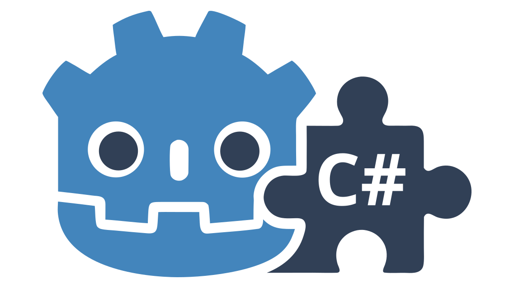
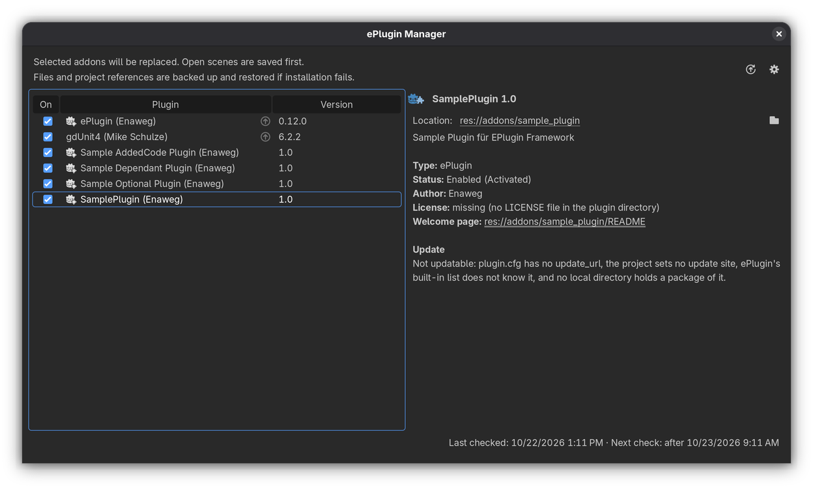
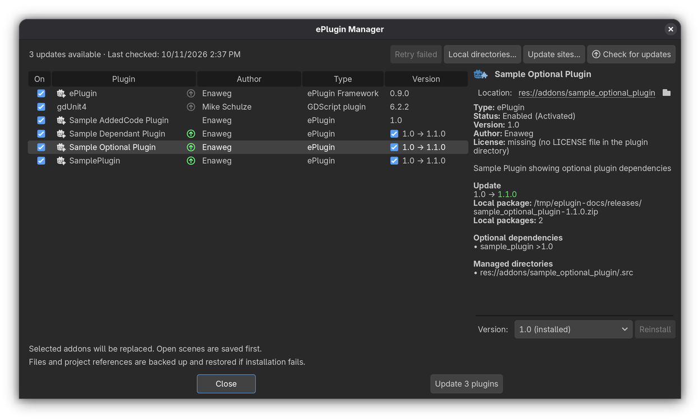

<div align="center">



# ePlugin Framework

**Extended C# Plugin Framework for [Godot](https://godotengine.org/).**

[](https://github.com/enaweg/godot-epluginframework/actions/workflows/ci-pr.yml)
[](https://github.com/enaweg/godot-epluginframework/actions/workflows/ci-analysis.yml)
[](https://github.com/enaweg/godot-epluginframework/actions/workflows/ci-codeql.yml)
[](https://github.com/enaweg/godot-epluginframework/tree/coverage)


</div>

ePlugin Framework adds declarative dependency and resource management to Godot editor plugins written in C#. A plugin describes its requirements once, and the framework applies them when it is enabled and removes them when it is disabled.

## Requirements and installation

The project targets `net8.0`. The current CI-tested setup is [Godot 4.7.2 .NET](https://godotengine.org/download/archive/4.7.2-stable/) with the [.NET 8](https://dotnet.microsoft.com/download/dotnet/8.0) and [.NET 10](https://dotnet.microsoft.com/download/dotnet/10.0) SDKs. Other tested combinations are listed under [Testing](#testing).

Install [ePlugin Framework from the Godot Asset Store](https://store.godotengine.org/asset/enaweg/eplugin-framework/), or download a [release](https://github.com/enaweg/godot-epluginframework/releases) and copy its `addons/ePlugin` directory into your project's `addons` folder. Open the project in the Godot .NET editor and build it (**Build** at the top right; a project without C# code needs **Project > Tools > C# > Create C# solution** first), so Godot can load the plugin's C# script. Then enable **ePlugin** under **Project > Project Settings > Plugins**, followed by the ePlugins you want to use.

Release archives include a small shared progress helper (about 80 KB) that runs on the installed .NET runtime and draws its window with native UI. Source checkouts generate the helper during a normal build. Linux needs GTK 3 for that window. Plugin operations continue if the helper is missing or fails. Asset Library distributions should use the release archive to include the helper.

## Features

ePlugin works with plugins that have a `plugin.cfg` in their folder below `res://addons` (`res://addons/<slug>/plugin.cfg`), whatever their type: ePlugins, plain C#, GDScript and GDExtension plugins, and with GDExtensions in their own folder without one. Other add-ons without a `plugin.cfg`, such as a script library or an asset pack, are not supported.

For plugin authors:

- **Declarative plugin recipes** install NuGet packages, C# projects and project references, autoloads, and managed directories on activation, then reverse those changes on deactivation. Declarations are checked when the recipe is created, so a mistake fails the activation with a clear message. Removing something that is already gone counts as done. NuGet sources are recorded in the project-root `nuget.config` for reproducible restores.
- **Managed directories** keep plugin code that needs those packages or projects hidden (for example as `.src`) until the plugin is enabled, so the plugin's root code always compiles. A GDExtension in them must be reloadable; it is loaded when the directory is shown and unloaded before it is hidden.
- **Plugin dependencies** enable required C#, GDScript or GDExtension plugins first (GDExtensions without `plugin.cfg` are always available), check version constraints, and disable dependants when a required plugin is disabled. Dependency cycles fail the activation instead of stalling it.
- **Optional dependencies** apply a nested resource recipe only while another plugin is enabled and matches its version, in whichever order the two are enabled. They never enable the other plugin or fail the declaring plugin's activation.
- **Licenses and welcome pages** can be declared in the recipe or in `plugin.cfg`; by default the plugin's `LICENSE` and README are used. **Links**: `documentation_url` and `source_url` in `plugin.cfg` appear in the ePlugin Manager.
- **Startup initializers** let code in managed directories run `IInitialize` callbacks once the framework is ready.
- **Progress and logging**: `EPlugin.Progress` shows a C# plugin's own long-running editor work in the progress window. A logging plugin such as [godot-elogger](https://github.com/enaweg/godot-elogger) can take over ePlugin's logging; there is no public API for that, but plugin code is compiled into the project's assembly, so it can pass its `ILoggerFactory` to the internal `EGlobal.Instance.SwitchLogging` once ePlugin is initialized.
- **Updatable releases** need only an `update_url` in `plugin.cfg` pointing at GitHub, GitLab, Forgejo or Gitea (Codeberg) releases or a Git repository.
- **GDScript plugins** get updates, licenses, welcome pages, links, and can be dependencies of ePlugins, with only keys in `plugin.cfg` and no code. See [GDScript plugins](docs/gdscript-plugins.md).
- **GDExtension plugins** (plugins with a `plugin.cfg` that ship native libraries) get the same, and ePlugins can ship a GDExtension too. Updates replace the libraries the editor has loaded and reload them in place or restart the editor, after checking the Godot versions and platforms the new libraries support. GDExtensions without a `plugin.cfg` are listed and updated too, with the version ePlugin installed. See [GDExtension plugins](docs/gdextension-plugins.md).

For everyone working on the project:

- **ePlugin Manager** lists every plugin below `res://addons` (ePlugins, plain C#, GDScript and GDExtension plugins, and GDExtensions without `plugin.cfg`) with its state, installs new ones from a ZIP file such as an Asset Library download, enables and disables them, checks for updates, selects versions (including downgrades and reinstalls), manages local package directories and update sites, and lists interrupted or failed work in its own dialog with a decision per plugin (retry, roll back, disable). Plugin details link the license, welcome page, documentation, source, and update site of each plugin. Its toolbar button turns green while an update can be installed and red while a plugin failed, waits for a decision under **Needs attention**, or has a GDExtension that Godot did not load.
- **Plugin updates** support GitHub, GitLab and Forgejo/Gitea releases (Codeberg and self-hosted instances included), Git tags and branches, and ZIP packages in user-configured local directories. Updates are downloaded and validated as a batch, backed up, built, and rolled back on failure. Native GDExtension libraries are replaced next to the copies the editor has loaded; dependent plugins are installed together and independent ones separately, so one failing update does not undo the others. Packages with warnings, a new update host or a refusal are shown in their own review dialog before installation.
- **Updates that only break the project's code** are kept: when a new version changes an API the project's own scripts use but every plugin still compiles, the update stays installed so the project can be adapted to it. The plugin's details list the remaining errors and can roll the update back. See [Updating plugins](docs/updating-plugins.md#updates-that-only-break-the-projects-code).
- **Update sites** come from a project's committed `addons/eplugin-update-sites.json`, a plugin's own `update_url`, or a built-in list of popular Godot add-ons, tried in that order. A site that fails or is unsupported falls back to the next one, so add-ons without an `update_url` can be updated too.
- **Plugin licenses** can be required before a plugin is enabled or updated. Accepted licenses are recorded per project, and dependencies enabled together are reviewed in one dialog.
- **Welcome pages** greet users once per project after a plugin is installed.
- **Progress window**: a separate native window (Windows, macOS, and Linux with GTK 3) shows enabling, disabling, update checks, downloads, and installation while the editor is busy.
- **Recovery**: interrupted or failed work is recorded per user and can be retried; an update interrupted by a crash resumes or rolls back on the next start, and a framework self-update that breaks the editor is restored automatically. A failed build keeps the editor's last built assembly, so the C# plugins and the ePlugin Manager's **Needs attention** dialog are still there after a restart.
- **Assembly reload safety** rebuilds framework state after Godot reloads C# assemblies, and the ePlugin Manager waits for a pending reload before it starts the next action.
- **Plugin state tracking** records acknowledged versions, completed lifecycle operations, accepted licenses, and shown welcome pages in a committed project file, so the whole team shares them.
- **Debug logging**: the `eplugin/logging/debug` project setting logs every dotnet command ePlugin runs.

| [ePlugin Manager](docs/eplugin-manager.md) | [Available updates](docs/updating-plugins.md#checks-and-installation) |
|---|---|
|  |  |

Screenshots show the repository's sample plugins and example update packages.

## Documentation

- [Create an ePlugin](docs/creating-plugins.md): starter code, recipe resources, dependencies, helpers, and initializers.
- [GDScript plugins](docs/gdscript-plugins.md): what ePlugin offers a GDScript plugin without code (updates, licenses, welcome pages, links, dependencies) and how to set it up.
- [GDExtension plugins](docs/gdextension-plugins.md): plugins, ePlugins and add-ons without `plugin.cfg` that ship a GDExtension, how updates replace native libraries the editor has loaded, and how to publish them.
- [ePlugin Manager](docs/eplugin-manager.md): inspect and control plugins, check updates, manage local sources and update sites, and decide about failed work.
- [Progress dialog](docs/progress-dialog.md): automatic progress feedback, the public reporting API, shared windows, restarts, and failure handling.
- [Updating plugins](docs/updating-plugins.md): configure update sources, project and built-in update sites, publish packages, and understand review, validation, builds, kept updates, and recovery.
- [Plugin state files](docs/plugin-state.md): checked-in state, per-user recovery state, and manual retry.
- [Plugin licenses](docs/plugin-licenses.md): ask users to accept a plugin's license before it is enabled or updated.
- [Plugin welcome pages](docs/plugin-welcome.md): greet users once after a plugin is installed, by default with its README.

The repository includes a sample project under `src/eplugin-framework` with examples for required and optional dependencies, managed directories, startup initializers, and welcome pages.

## Motivation and limitations

Godot plugins do not provide a built-in way to manage C# project references or NuGet packages, and external C# plugin code can trigger assembly reloads that discard editor state. ePlugin Framework handles those project changes around plugin lifecycle events.

Godot currently needs project-managed resource IDs for assets such as scenes, models, and scripts, so the framework cannot manage those assets outside the project. Plugin activation and deactivation can also freeze the editor while project changes are built. On supported desktop platforms the separate progress window remains responsive during that work. A failure in the middle of installing or removing a recipe can leave the project in a state that does not build; fix the cause and use **Retry** under **Needs attention** in the ePlugin Manager (see [Plugin state files](docs/plugin-state.md)).

Only plugins with a `plugin.cfg` are supported, whatever their type, and GDExtensions without one. Other add-ons without one are not listed in the ePlugin Manager, cannot be updated, enabled or required as a dependency, and get no license or welcome page. A GDExtension without `plugin.cfg` has no version in its files; until ePlugin installed one, its version is unknown and no update is offered for it.

Updates replace whole addon folders. They do not install missing plugins or resolve dependencies from remote sources. GDExtensions inside directories managed with `AddDirectory` must be reloadable. Update builds compile only C#, so an update that breaks GDScript code is not detected.

## Testing

CI tests pull requests and pushes to `main` with Godot 4.7.2 and both the .NET 8 and the .NET 10 SDK, which use different dotnet command forms, and builds the framework against the Godot 4.6.2, 4.5.1 and 4.4.1 SDKs. Running it on those older Godot versions is tested by hand.

Static analysis also runs SDK analyzers, dependency vulnerability auditing, workflow lint and CodeQL security checks on pull requests and `main`. Counts appear in the PR's CI comment and workflow summaries, and findings appear in code-scanning views. See [Static analysis in CI](docs/static-analysis.md) for the policy, reports and local commands.

The tests also measure the framework's line coverage. The PR's CI comment shows its coverage, the change against `main` and which of its changed lines no test runs; the history of `main` is kept on the [`coverage` branch](https://github.com/enaweg/godot-epluginframework/tree/coverage). See [Code coverage](docs/code-coverage.md).

Every pull request is also packaged like a release by the **CI-PR-Build** workflow, which CI-PR runs first. Its ZIP carries the PR number as a semver prerelease (`0.12.0` becomes `0.12.0-pr.42`), so the release of that version still counts as an update. Its download link is posted as the pull request's CI comment as soon as the package is built; when all jobs have finished, CI-PR updates that one comment with the result of each job, the static analysis and the coverage. Pull requests from forks find all of it in the workflow run's summary. Downloading needs a GitHub login. Copy the archive's `addons/ePlugin` directory into a project to try the change.

```bash
cd src/eplugin-framework
dotnet build "EPluginFramework.sln" --configuration Debug
dotnet test "EPluginFramework.sln" --configuration Debug --settings .runsettings
dotnet test ../activation-progress.Tests/ActivationProgress.Tests.csproj
```

The framework tests require a Godot .NET editor executable in `GODOT_BIN`. They drive the plugin lifecycle through a fake editor, because gdUnit4 cannot run inside the Godot editor. The progress helper's tests need only .NET. See the [CI workflow](https://github.com/enaweg/godot-epluginframework/blob/main/.github/workflows/ci-pr.yml) for the headless setup. Godot 4.5 and newer have an [EditorPlugin regression](https://github.com/godotengine/godot/issues/110971), so the framework uses an interface-based plugin API.

## Plugins using ePlugin Framework

- [godot-elogger](https://github.com/enaweg/godot-elogger) — Zero-allocation text and structured logging with ZLogger for Godot .NET, which can also take over ePlugin's own logging
- [godot-econtainer](https://github.com/enaweg/godot-econtainer) — VContainer, Unity's fast dependency injection container, ported to Godot .NET
- [godot-emessagepipe](https://github.com/enaweg/godot-emessagepipe) — MessagePipe support for Godot .NET, with optional eContainer integration

## Contribute

Contributions to documentation, testing, and code are welcome.

Commercial services are available from [Enaweg](https://www.enaweg.at) for consulting, implementation assistance, and tailored development.

## License

Licensed under the [MIT license](LICENSE).
