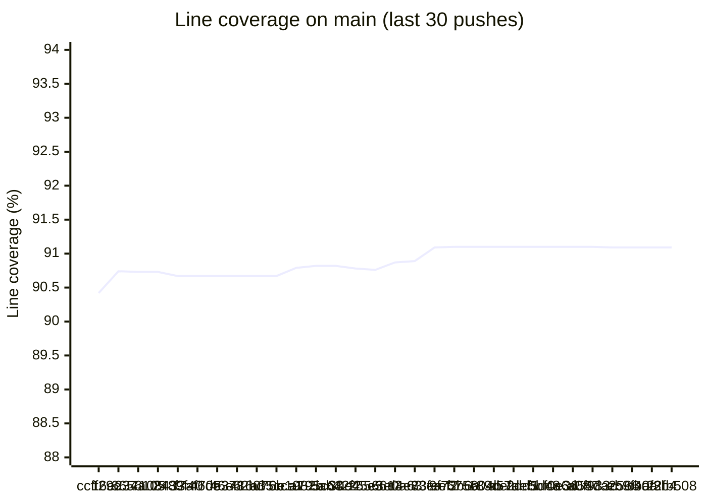

# Code coverage history

Line coverage of `src/eplugin-framework/addons/ePlugin` on `main`, recorded by the CI-PR workflow after every push. This branch is generated; do not edit it.

**91.09%** (12960 of 14228 lines) at [22fb508](https://github.com/enaweg/godot-epluginframework/commit/22fb50855bca4ff90f05ed2344010f3c3452eac4), 2026-11-13.

| Date | Commit | Line coverage | Change |
|:--|:--|--:|--:|
| 2026-11-13 | [22fb508](https://github.com/enaweg/godot-epluginframework/commit/22fb50855bca4ff90f05ed2344010f3c3452eac4) | 91.09% | +0.00 pp |
| 2026-11-13 | [c40f3b4](https://github.com/enaweg/godot-epluginframework/commit/c40f3b46430ac8e9f75d19655800cc6cd3175b48) | 91.09% | +0.00 pp |
| 2026-11-13 | [eb9fbaa](https://github.com/enaweg/godot-epluginframework/commit/eb9fbaad7c46aea79665d19bcae820f845107f6e) | 91.09% | +0.00 pp |
| 2026-11-13 | [4da2566](https://github.com/enaweg/godot-epluginframework/commit/4da2566edc71f717ea5842f38e3e45b834a53db7) | 91.09% | -0.01 pp |
| 2026-11-13 | [a0f933d](https://github.com/enaweg/godot-epluginframework/commit/a0f933d32d71c96f3f663a47062a2aeb4e1de240) | 91.10% | +0.00 pp |
| 2026-11-13 | [4a6d557](https://github.com/enaweg/godot-epluginframework/commit/4a6d55732de279d96ed8e53fde63beb74856cb5f) | 91.10% | +0.00 pp |
| 2026-11-13 | [5bf0e36](https://github.com/enaweg/godot-epluginframework/commit/5bf0e36eb80e0d8700e79cad869246c83eb49bf4) | 91.10% | +0.00 pp |
| 2026-11-07 | [2dd5dc8](https://github.com/enaweg/godot-epluginframework/commit/2dd5dc8d282ce296f014c43168ebcb3e479f4f4d) | 91.10% | +0.00 pp |
| 2026-11-07 | [a57def1](https://github.com/enaweg/godot-epluginframework/commit/a57def1e1d3f88deefe432de171bbe5625b3517d) | 91.10% | +0.00 pp |
| 2026-11-06 | [189defa](https://github.com/enaweg/godot-epluginframework/commit/189defacd1d3422982187d42b515637c8e28a7d9) | 91.10% | +0.00 pp |
| 2026-11-06 | [675604b](https://github.com/enaweg/godot-epluginframework/commit/675604b3689bd94a711f32b80b6e3c78a2b2432c) | 91.10% | +0.00 pp |
| 2026-11-06 | [9f73b6a](https://github.com/enaweg/godot-epluginframework/commit/9f73b6a1d1736fd3f74579912ddf652bc9a2184c) | 91.10% | +0.01 pp |
| 2026-11-06 | [73feef2](https://github.com/enaweg/godot-epluginframework/commit/73feef2bbc230a826725adbacaf0a1a3156cc119) | 91.09% | +0.20 pp |
| 2026-11-06 | [d4e83ea](https://github.com/enaweg/godot-epluginframework/commit/d4e83eaf411289041ca3be9b9b85516869441cf1) | 90.89% | +0.02 pp |
| 2026-11-06 | [e3e0a63](https://github.com/enaweg/godot-epluginframework/commit/e3e0a63d28287e241f9ed2b3d24cf725592330af) | 90.87% | +0.11 pp |
| 2026-11-06 | [2556613](https://github.com/enaweg/godot-epluginframework/commit/2556613aea980557fe62fc4606bfdb1a177254a1) | 90.76% | -0.02 pp |
| 2026-11-06 | [30e45c5](https://github.com/enaweg/godot-epluginframework/commit/30e45c5c164e05b91811e51e1f02dafcbefaf0a2) | 90.78% | -0.04 pp |
| 2026-11-06 | [5ab42f2](https://github.com/enaweg/godot-epluginframework/commit/5ab42f2d58348bebde8a42a6e59969ef386722a5) | 90.82% | +0.00 pp |
| 2026-11-05 | [a795c63](https://github.com/enaweg/godot-epluginframework/commit/a795c63e7f365824f05f8417961256e8f7b56580) | 90.82% | +0.03 pp |
| 2026-11-05 | [0e1982b](https://github.com/enaweg/godot-epluginframework/commit/0e1982b1d490eda2a58a73a5b940cfaa2eea43f5) | 90.79% | +0.12 pp |
| 2026-11-05 | [a35cca1](https://github.com/enaweg/godot-epluginframework/commit/a35cca15f866ff195b15f17b8c9ef6f5e518a526) | 90.67% | +0.00 pp |
| 2026-11-05 | [416075b](https://github.com/enaweg/godot-epluginframework/commit/416075b4705fe3066db5a84c32a8b8f2c1173be2) | 90.67% | +0.00 pp |
| 2026-11-04 | [46e62bd](https://github.com/enaweg/godot-epluginframework/commit/46e62bd67ed0dfb13a25deaf0a46e724643c2176) | 90.67% | +0.00 pp |
| 2026-11-04 | [470e378](https://github.com/enaweg/godot-epluginframework/commit/470e37885c0771effab54813d8b59c4fbb4b76fa) | 90.67% | +0.00 pp |
| 2026-11-04 | [f7af6d5](https://github.com/enaweg/godot-epluginframework/commit/f7af6d5c88647f534369c15710ad657fb98e1584) | 90.67% | +0.00 pp |
| 2026-11-04 | [2489f40](https://github.com/enaweg/godot-epluginframework/commit/2489f40735a3aeeb7a4b54bc61e3b3b2d6202b0b) | 90.67% | -0.06 pp |
| 2026-11-04 | [7108433](https://github.com/enaweg/godot-epluginframework/commit/7108433c82ef3c67c453aa0c9d9a4671a11f1d17) | 90.73% | +0.00 pp |
| 2026-11-04 | [6656105](https://github.com/enaweg/godot-epluginframework/commit/66561051f94df83d019f318ca65ad182b5d0096b) | 90.73% | -0.01 pp |
| 2026-11-04 | [16e234a](https://github.com/enaweg/godot-epluginframework/commit/16e234a90acd0015e27a026d47a06d5844681838) | 90.74% | +0.32 pp |
| 2026-11-04 | [ccff29c](https://github.com/enaweg/godot-epluginframework/commit/ccff29cd51bc22d71418a90ef5d8d87c30bbd446) | 90.42% | -0.24 pp |

All measurements: [history.csv](history.csv).

Files at 22fb508 (163)

| File | Line coverage | Covered lines |
|:--|--:|--:|
| `Internal/ExportFilter.cs` | 0.0% | 0 of 4 |
| `Internal/ProjectSettingsDialog.cs` | 9.4% | 5 of 53 |
| `EPlugin.cs` | 33.3% | 4 of 12 |
| `Internal/AssemblyUnloadCleanup.cs` | 38.9% | 7 of 18 |
| `Internal/EditorHost.cs` | 56.6% | 47 of 83 |
| `EPluginPlugin.cs` | 59.4% | 202 of 340 |
| `Internal/Manager/EPluginManagerDialog.Versions.cs` | 65.6% | 63 of 96 |
| `Internal/EGlobal.UpdateApply.cs` | 65.8% | 200 of 304 |
| `Internal/Manager/EditorWindows.cs` | 68.8% | 55 of 80 |
| `Internal/Manager/EPluginManagerDialog.Operations.cs` | 73.0% | 127 of 174 |
| `Internal/PluginTypes.cs` | 73.9% | 17 of 23 |
| `Internal/Manager/GeneralSettingsTab.cs` | 74.0% | 54 of 73 |
| `Internal/Manager/CleanupSuggestionDialog.cs` | 75.0% | 21 of 28 |
| `Logging/GodotConsoleLogger.cs` | 76.7% | 33 of 43 |
| `Internal/Manager/StartupFailureDialog.cs` | 77.1% | 27 of 35 |
| `Internal/ProgressSession.cs` | 78.8% | 171 of 217 |
| `Internal/EGlobal.LocalSources.cs` | 79.3% | 46 of 58 |
| `Internal/StateFileProblem.cs` | 81.5% | 22 of 27 |
| `Internal/Manager/EPluginManagerDialog.Updates.cs` | 81.7% | 49 of 60 |
| `Internal/EGlobal.Transitions.cs` | 81.7% | 192 of 235 |
| `Internal/EGlobal.AddonInstall.cs` | 82.4% | 28 of 34 |
| `Internal/ActivationProgress.cs` | 82.7% | 253 of 306 |
| `Internal/EGlobal.Updates.cs` | 83.2% | 124 of 149 |
| `Internal/Dotnet/DotnetFailure.cs` | 83.7% | 36 of 43 |
| `Internal/Manager/EPluginManagerDialog.Zip.cs` | 84.5% | 71 of 84 |
| `Internal/Update/AddonInstaller.cs` | 85.9% | 61 of 71 |
| `Internal/AssemblyReload.cs` | 86.2% | 25 of 29 |
| `Internal/EGlobal.Retry.cs` | 86.2% | 138 of 160 |
| `Internal/Update/UpdateErrors.cs` | 86.3% | 82 of 95 |
| `Internal/Manager/EPluginManagerDialog.cs` | 86.7% | 353 of 407 |
| `Internal/Manager/UpdateFailureDialog.cs` | 87.0% | 60 of 69 |
| `EditorPluginExtensions.cs` | 87.5% | 63 of 72 |
| `Internal/Manager/UpdateReviewDialog.cs` | 87.8% | 72 of 82 |
| `Internal/Kinds/GDExtensionRules.cs` | 88.2% | 30 of 34 |
| `Internal/EGlobal.Activation.cs` | 88.8% | 317 of 357 |
| `Internal/EGlobal.UpdateWorkflow.cs` | 88.9% | 8 of 9 |
| `Internal/Manager/SettingsDialog.cs` | 88.9% | 48 of 54 |
| `Internal/Manager/ToolsTab.cs` | 89.3% | 209 of 234 |
| `Internal/PluginTextFile.cs` | 89.5% | 34 of 38 |
| `Internal/Kinds/NativeExtensionStatus.cs` | 89.7% | 26 of 29 |
| `Internal/EGlobal.RecipeOperations.cs` | 89.8% | 114 of 127 |
| `Internal/ShowHideHelper.cs` | 90.2% | 111 of 123 |
| `Internal/Update/PluginRepository.cs` | 90.6% | 135 of 149 |
| `Internal/EGlobal.MissingPlugins.cs` | 90.6% | 29 of 32 |
| `Internal/EGlobal.PlainPlugins.cs` | 91.4% | 128 of 140 |
| `Internal/Update/UpdateApplier.cs` | 91.5% | 376 of 411 |
| `Internal/Update/AddonSwap.cs` | 92.1% | 129 of 140 |
| `Internal/Update/UpdateStateStore.cs` | 92.6% | 50 of 54 |
| `Internal/EGlobal.PluginManager.cs` | 93.1% | 95 of 102 |
| `Internal/Manager/UpdateSourcesTab.cs` | 93.2% | 286 of 307 |
| `Internal/EGlobal.cs` | 93.2% | 274 of 294 |
| `Internal/EGlobal.Welcomes.cs` | 93.2% | 69 of 74 |
| `Internal/Licenses/PluginLicense.cs` | 93.8% | 15 of 16 |
| `Internal/Manager/ManagerReopenMarker.cs` | 94.1% | 16 of 17 |
| `Internal/AddonLayout.cs` | 94.3% | 100 of 106 |
| `Internal/Update/GitSource.cs` | 94.4% | 204 of 216 |
| `Internal/Update/UpdateBuildGate.cs` | 94.6% | 70 of 74 |
| `Internal/EGlobal.UnsavedState.cs` | 94.7% | 18 of 19 |
| `Internal/Update/PluginCode.cs` | 94.7% | 18 of 19 |
| `Internal/Update/SubmoduleSwap.cs` | 94.9% | 37 of 39 |
| `Internal/Update/PackageFetcher.cs` | 94.9% | 112 of 118 |
| `Internal/Dotnet/ProjectReferences.cs` | 95.0% | 38 of 40 |
| `Internal/Manager/EditorIcons.cs` | 95.0% | 57 of 60 |
| `Internal/Update/SubmoduleSource.cs` | 95.1% | 97 of 102 |
| `Internal/EGlobal.EditorThread.cs` | 95.5% | 21 of 22 |
| `Internal/EGlobal.Deactivation.cs` | 95.6% | 152 of 159 |
| `Internal/PluginStateStore.cs` | 95.7% | 243 of 254 |
| `Internal/Update/InterimBridge.cs` | 95.7% | 45 of 47 |
| `Internal/Update/UpdateModels.cs` | 95.8% | 68 of 71 |
| `Internal/EGlobal.Licenses.cs` | 95.9% | 278 of 290 |
| `Internal/Manager/WelcomeDialog.cs` | 96.0% | 48 of 50 |
| `Internal/Update/LocalIndexCache.cs` | 96.0% | 24 of 25 |
| `Internal/Dotnet/NugetConfigManager.cs` | 96.2% | 200 of 208 |
| `Internal/Update/BuildDiagnostics.cs` | 96.3% | 52 of 54 |
| `Internal/Kinds/GDExtensionPluginWorkflow.cs` | 96.3% | 79 of 82 |
| `Internal/Manager/UpdateFlow.cs` | 96.4% | 238 of 247 |
| `Internal/EGlobal.OptionalDependencies.cs` | 96.4% | 107 of 111 |
| `Internal/Update/UpdateRecovery.cs` | 96.5% | 164 of 170 |
| `Internal/Dotnet/XmlFile.cs` | 96.5% | 55 of 57 |
| `Internal/Manager/LicenseDialog.cs` | 96.6% | 168 of 174 |
| `Internal/Update/SafeZipExtractor.cs` | 96.7% | 88 of 91 |
| `Internal/Update/UpdateService.cs` | 96.8% | 120 of 124 |
| `Internal/PluginStateStore.Attempts.cs` | 97.0% | 131 of 135 |
| `Internal/SharedStateMerge.cs` | 97.1% | 33 of 34 |
| `Internal/PluginStateDocuments.cs` | 97.2% | 138 of 142 |
| `Internal/Manager/PluginAttention.cs` | 97.2% | 106 of 109 |
| `Internal/Dotnet/ExecuteCliBase.cs` | 97.3% | 36 of 37 |
| `Internal/Kinds/PluginKinds.cs` | 97.8% | 44 of 45 |
| `Internal/Manager/ZipInstall.cs` | 97.8% | 44 of 45 |
| `Internal/Update/LocalPackageIndex.cs` | 97.9% | 92 of 94 |
| `Internal/Update/RecipeReconciler.cs` | 98.0% | 50 of 51 |
| `Internal/Dotnet/BuildOutputGuard.cs` | 98.1% | 52 of 53 |
| `Internal/TransitionCoordinator.cs` | 98.2% | 54 of 55 |
| `Internal/Manager/AttentionDialog.cs` | 98.2% | 111 of 113 |
| `Internal/Manager/PluginManagerViewModel.cs` | 98.3% | 341 of 347 |
| `Internal/Update/AddonPackageValidator.cs` | 98.4% | 179 of 182 |
| `Internal/Dotnet/ReleaseConfiguration.cs` | 98.6% | 71 of 72 |
| `Internal/Update/UpdateJournal.cs` | 98.7% | 78 of 79 |
| `Internal/EGlobal.UpdateRecipes.cs` | 99.0% | 192 of 194 |
| `Internal/Update/ReleaseSources.cs` | 99.0% | 195 of 197 |
| `Internal/Update/LocalCleanup.cs` | 99.0% | 98 of 99 |
| `Internal/Update/PackageFiles.cs` | 99.1% | 105 of 106 |
| `Internal/Update/UpdateHttp.cs` | 99.2% | 120 of 121 |
| `Internal/Dotnet/DotnetCliBase.cs` | 99.4% | 160 of 161 |
| `Internal/Kinds/GDExtensionConfig.cs` | 99.4% | 166 of 167 |
| `EEditorPluginMetadata.cs` | 100.0% | 4 of 4 |
| `IEEditorPluginExtensions.cs` | 100.0% | 15 of 15 |
| `Internal/AttemptReasons.cs` | 100.0% | 7 of 7 |
| `Internal/Dotnet/DotnetCli10.cs` | 100.0% | 5 of 5 |
| `Internal/Dotnet/DotnetCli9.cs` | 100.0% | 5 of 5 |
| `Internal/Dotnet/DotnetVersionManager.cs` | 100.0% | 39 of 39 |
| `Internal/Dotnet/ICheckedDotnetCli.cs` | 100.0% | 1 of 1 |
| `Internal/Dotnet/PluginsOnlyBuild.cs` | 100.0% | 32 of 32 |
| `Internal/EEditorPluginBuilder.cs` | 100.0% | 68 of 68 |
| `Internal/EEditorPluginRecipe.cs` | 100.0% | 13 of 13 |
| `Internal/EEditorPluginSubRecipeBuilder.cs` | 100.0% | 35 of 35 |
| `Internal/EGlobal.ExtensionAddons.cs` | 100.0% | 17 of 17 |
| `Internal/EGlobal.LocalCleanup.cs` | 100.0% | 20 of 20 |
| `Internal/EGlobal.Recipes.cs` | 100.0% | 26 of 26 |
| `Internal/EGlobal.UpdateSites.cs` | 100.0% | 28 of 28 |
| `Internal/EPluginProgress.cs` | 100.0% | 1 of 1 |
| `Internal/EPluginSettings.cs` | 100.0% | 8 of 8 |
| `Internal/ExportExclusions.cs` | 100.0% | 9 of 9 |
| `Internal/FrameThrottle.cs` | 100.0% | 9 of 9 |
| `Internal/Kinds/CSharpPluginWorkflow.cs` | 100.0% | 4 of 4 |
| `Internal/Kinds/EPluginWorkflow.cs` | 100.0% | 14 of 14 |
| `Internal/Kinds/FrameworkPluginWorkflow.cs` | 100.0% | 7 of 7 |
| `Internal/Kinds/GDScriptPluginWorkflow.cs` | 100.0% | 4 of 4 |
| `Internal/Kinds/PluginKindWorkflow.cs` | 100.0% | 14 of 14 |
| `Internal/Kinds/UnknownPluginWorkflow.cs` | 100.0% | 4 of 4 |
| `Internal/Licenses/LicenseReview.cs` | 100.0% | 68 of 68 |
| `Internal/Licenses/LicenseSettings.cs` | 100.0% | 2 of 2 |
| `Internal/LoggingSettings.cs` | 100.0% | 2 of 2 |
| `Internal/Manager/AboutTab.cs` | 100.0% | 57 of 57 |
| `Internal/Manager/DialogLifetime.cs` | 100.0% | 25 of 25 |
| `Internal/Manager/EditorSignalConnections.cs` | 100.0% | 12 of 12 |
| `Internal/Manager/ManagerSession.cs` | 100.0% | 9 of 9 |
| `Internal/Manager/ObservedTask.cs` | 100.0% | 4 of 4 |
| `Internal/Manager/PluginCatalog.cs` | 100.0% | 10 of 10 |
| `Internal/Manager/PluginOperationGate.cs` | 100.0% | 11 of 11 |
| `Internal/Manager/TextColors.cs` | 100.0% | 15 of 15 |
| `Internal/Manager/UpdateReview.cs` | 100.0% | 67 of 67 |
| `Internal/PlainPluginObserver.cs` | 100.0% | 74 of 74 |
| `Internal/PluginContext.cs` | 100.0% | 13 of 13 |
| `Internal/PluginToggles.cs` | 100.0% | 13 of 13 |
| `Internal/RecipeEntries.cs` | 100.0% | 69 of 69 |
| `Internal/Update/AddonArchive.cs` | 100.0% | 48 of 48 |
| `Internal/Update/KnownPlugins.Data.cs` | 100.0% | 1040 of 1040 |
| `Internal/Update/KnownPlugins.cs` | 100.0% | 6 of 6 |
| `Internal/Update/LocalSourceSettings.cs` | 100.0% | 56 of 56 |
| `Internal/Update/ProjectBackup.cs` | 100.0% | 34 of 34 |
| `Internal/Update/RecipeSnapshot.cs` | 100.0% | 27 of 27 |
| `Internal/Update/SemVer.cs` | 100.0% | 46 of 46 |
| `Internal/Update/UidMap.cs` | 100.0% | 16 of 16 |
| `Internal/Update/UpdateGroups.cs` | 100.0% | 20 of 20 |
| `Internal/Update/UpdatePaths.cs` | 100.0% | 3 of 3 |
| `Internal/Update/UpdateSettings.cs` | 100.0% | 10 of 10 |
| `Internal/Update/UpdateSiteSettings.cs` | 100.0% | 52 of 52 |
| `Internal/VersionConstraint.cs` | 100.0% | 25 of 25 |
| `Internal/Welcomes/PluginWelcome.cs` | 100.0% | 18 of 18 |
| `Internal/Welcomes/WelcomeSettings.cs` | 100.0% | 2 of 2 |
| `Logging/GenericLoggerFactory.cs` | 100.0% | 7 of 7 |
| `Logging/NullLogger.cs` | 100.0% | 6 of 6 |

