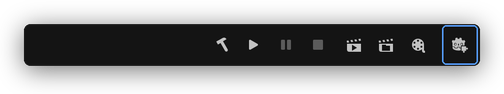
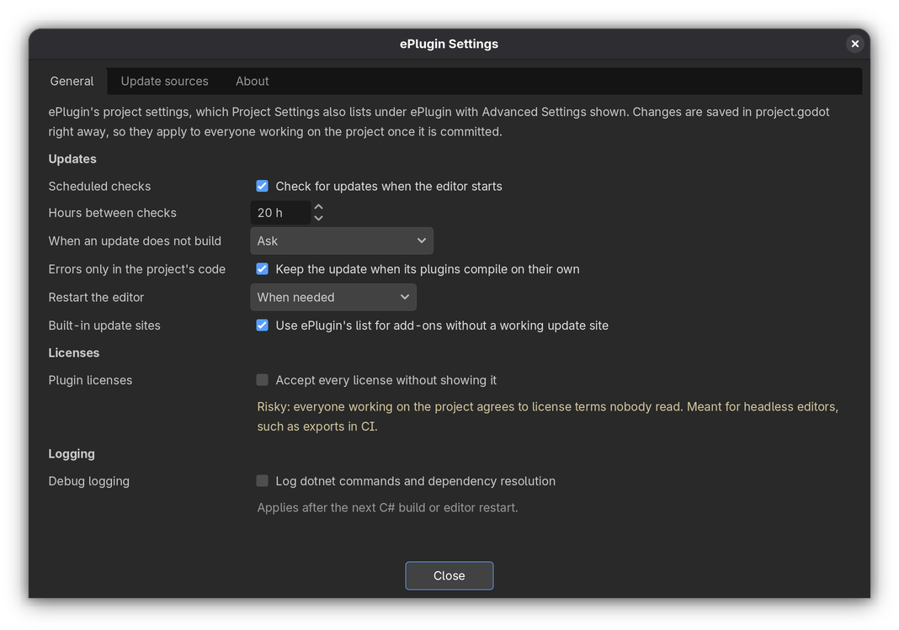

# ePlugin Manager

Open **ePlugin Manager** with the ePlugin button at the right of the editor's main toolbar or from **Project > Tools > ePlugin Manager...**.

The puzzle piece of the button turns red while a plugin failed, a failed attempt waits for **Retry failed**, or Godot did not load a GDExtension that it should (see [GDExtension plugins](gdextension-plugins.md#in-the-eplugin-manager)), and green while an update can be installed. Red takes precedence. Updates that cannot be installed leave the button unchanged.

The overview above uses the repository's sample plugins in Godot's default dark editor theme.

The manager lists plugins below `res://addons`, whether they are enabled or not. Only folders with a `plugin.cfg` (`res://addons/<slug>/plugin.cfg`) are plugins; add-ons without one are not listed, except GDExtensions, which are listed as [GDExtension add-ons](gdextension-plugins.md#gdextensions-without-plugincfg) that are always loaded and cannot be enabled or disabled. It shows each plugin's name with its author in parentheses, its version, and its enabled state; the details of the selected plugin also show its type (ePlugin Framework, ePlugin, C# plugin, GDScript plugin, [GDExtension plugin](gdextension-plugins.md), or GDExtension add-on). ePlugins have the ePlugin icon. A plugin with an `update_url` or a matching local package gets an update indicator when a newer version is available; the Version column shows the installed and available versions and lets you select updates.

Select a plugin to see its status, author, documentation and source links, license, description, update source and warnings, earlier failures, and the dependencies declared by an active ePlugin recipe. Click the license to read it again; a plugin without a license of its own shows its missing `LICENSE` file as missing. A plugin with a [welcome page](plugin-welcome.md) links it as well, so it can be read again after it was shown. Click the plugin location to select it in the FileSystem dock, or use the folder button to open it in the system file manager. Documentation, source, update site and release page links open in the system browser. Plugins provide documentation and source links with `documentation_url` and `source_url` in `plugin.cfg` (see [Create an ePlugin](creating-plugins.md#documentation-and-source-links)).

## Actions

The buttons at the top right of the manager are icons: **Retry failed**, **Check for updates** and **Settings**, from left to right. Hover over one to see its name and what it does.

- **On** enables or disables the selected plugin. Enabling an ePlugin installs its recipe and required dependencies. Plugins that ask for their [license](plugin-licenses.md) to be accepted show it first. Once installed, a plugin shows its [welcome page](plugin-welcome.md) if it has one and it was not shown for the project yet. Disabling a plugin also disables plugins that require it. The manager refreshes the list after toggles. Disabling ePlugin Framework itself requires confirmation because it closes the manager.
- **Check for updates** checks immediately regardless of the scheduled interval and indexes local directories again.
- **Settings** opens ePlugin's settings, in four tabs (see [Settings](#settings)).
- **Update** installs the checked updates after validation and confirmation. See [Updating plugins](updating-plugins.md). Independent plugins are installed one after another, so a plugin that fails is rolled back without the others; a build failure is rolled back without asking. The manager stays open and reports the installed versions, and the plugins that were rolled back or skipped with their reason, when the update finishes; an update that restarts the editor reopens it afterwards.
- **Retry failed** retries activation, deactivation, or update work that failed or was interrupted. See [Plugin state files](plugin-state.md).
- A plugin whose update was kept although the project does not build with it, for example because only the project's own code has to be adapted, shows a **Kept update** section in its details: the versions, why it was kept, the remaining errors in the project's code, and a **Roll back to** link that restores the previous version. See [Updates that only break the project's code](updating-plugins.md#updates-that-only-break-the-projects-code).
- **Open release page** opens the release notes for the selected update.
- **Version** selects a published version for an enabled plugin with an `update_url` or a package in a local directory. Choose **Update** or **Downgrade** to install it, or **Reinstall** with the installed version selected to install it again: this gets new commits of a pinned Git branch whose version did not change, and repairs addon files changed in the project. Downgrades and reinstalls use the same download, validation, backup, and rollback flow as updates. When the project does not build with the installed version, a dialog asks whether to keep it, to fix the errors yourself and finish with **Retry failed**, or to roll it back (see [Builds, restart, and recovery](updating-plugins.md#builds-restart-and-recovery)). The ePlugin Framework itself cannot be downgraded because an older framework cannot complete or recover the update that installs it.

Long-running actions (enabling and disabling, **Retry failed**, **Check for updates**, downloading and installing) show their progress in ePlugin's separate progress window; the manager's status line at the bottom right reports the outcome. While updates are downloaded and installed, a **Cancel** button stops them; otherwise the manager has no button to close it, use the window's close button or Escape. After the C# project was rebuilt, for example by an activation or an IDE build, the actions wait until the editor has loaded the rebuilt code, and the status line says *Waiting for the editor to load the rebuilt C# code...* meanwhile. They become available again after at most 15 seconds, even if the editor does not reload.

The progress window comes from a small helper included in release archives (see [Requirements and installation](../README.md#requirements-and-installation)). The ePlugin logo fades in and splits apart around a panel whose progress bar and current step fade in. Closing reverses the animation from its current position without pausing on the joined logo. Short operations can finish without displaying a window.

Godot editors using compatible versions of ePlugin share one progress window, also with different projects open: it shows the most recent step of the operations that are still running, and an operation that starts while the window is still closing turns it back. The window closes when all operations end or no running operation has reported for 15 seconds; the helper behind it stays in the background for 15 minutes after the last report, so later operations can reuse it without starting another process.

Progress feedback is best effort. If the helper is unavailable or stops responding, plugin work continues and the manager still reports the outcome. Editors using incompatible versions of the progress helper use separate windows. See [Progress dialog](progress-dialog.md) for usage, timing, restart handoff, and failure handling.

## Settings

**Settings** opens a dialog with three tabs. It opens on **General** and reads every tab again each time.

- **General** shows ePlugin's project settings, the same ones Project Settings lists under ePlugin with **Advanced Settings** shown: the [update settings](updating-plugins.md#update-settings), [accepting licenses automatically](plugin-licenses.md#accepting-licenses-automatically), and [debug logging](creating-plugins.md#troubleshooting). A change is saved to `project.godot` right away, so it applies to everyone working on the project once it is committed. Turning on **Accept every license without showing it** asks for confirmation first. Hover over a setting to see its description and its name in Project Settings.
- **Update sources** lists where updates come from: the update sites the project sets for its plugins, your local directories with the plugin packages found in each, and ePlugin's read-only [built-in update sites](updating-plugins.md#built-in-update-sites). **Add site...**, **Edit...** and **Remove** change the project's update sites, which replace a plugin's `update_url` (still used when the site does not work) and are saved in the project; see [Project update sites](updating-plugins.md#project-update-sites). **Add directory...**, **Remove** and **Rescan** manage the local directories, folders with plugin ZIP packages that are user-wide settings; see [Local directories](updating-plugins.md#local-directories).
- **About** shows the installed ePlugin Framework's logo, version, and description, with links to its page in the Godot Asset Store, its source code, and its documentation. A highlighted note asks you to star the project on GitHub if it is useful to you, and links to its GitHub page, where the **Star** button is. The links open in the system browser.

## Scheduled checks

By default, update checks run once per editor session when the last successful check is at least 20 hours old. The manager's **Check for updates** action bypasses that interval. The status line shows when updates were last checked and when the next scheduled check runs: the first editor start after that time, *at the next editor start* when one is due already, or *off* when scheduled checks are disabled. Update settings are on the **General** tab of the [Settings](#settings); they are described in [Updating plugins](updating-plugins.md#update-settings).
