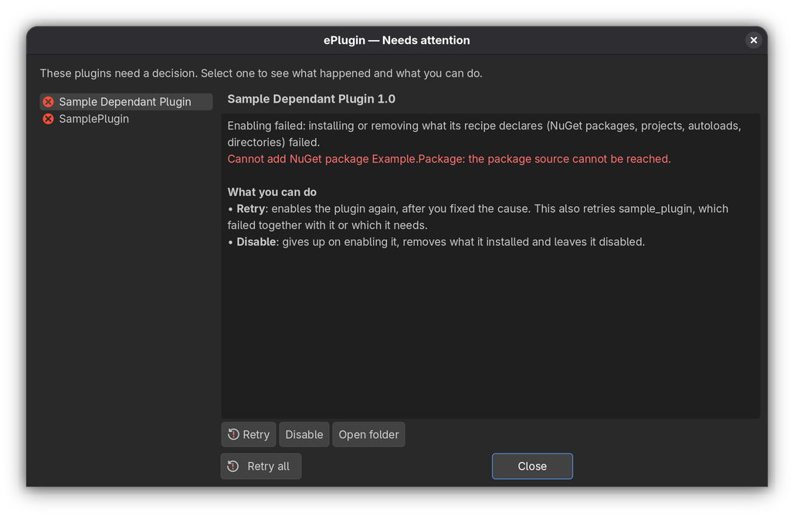
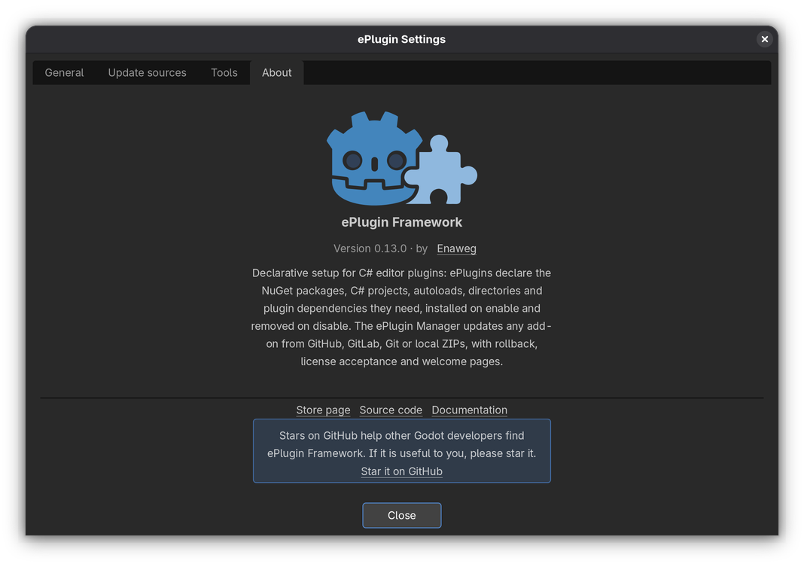

# ePlugin Manager

Open **ePlugin Manager** with the ePlugin button at the right of the editor's main toolbar or from **Project > Tools > ePlugin Manager...**.

The puzzle piece of the button turns red while a plugin [needs attention](#needs-attention): it failed, a failed attempt waits for a decision, or Godot did not load a GDExtension that it should (see [GDExtension plugins](gdextension-plugins.md#in-the-eplugin-manager)), and green while an update can be installed. Red takes precedence. Updates that cannot be installed leave the button unchanged.

The overview above uses the repository's sample plugins in Godot's default dark editor theme.

The manager lists plugins below `res://addons`, whether they are enabled or not. Only folders with a `plugin.cfg` (`res://addons/<slug>/plugin.cfg`) are plugins; add-ons without one are not listed, except GDExtensions, which are listed as [GDExtension add-ons](gdextension-plugins.md#gdextensions-without-plugincfg) that are always loaded and cannot be enabled or disabled. It shows each plugin's name with its author in parentheses, its version, and its enabled state; the details of the selected plugin also show its type (ePlugin Framework, ePlugin, C# plugin, GDScript plugin, [GDExtension plugin](gdextension-plugins.md), or GDExtension add-on). ePlugins have the ePlugin icon. A plugin whose folder is gone but that still has a failed attempt is listed as *Missing (no plugin.cfg)*, so the attempt can be resolved under [Needs attention](#needs-attention). A plugin with an update source (an `update_url`, a [project update site](updating-plugins.md#project-update-sites), an entry in the [built-in list](updating-plugins.md#built-in-update-sites), or a matching local package) gets an update indicator when a newer version is available; the Version column shows the installed and available versions and lets you select updates.

Select a plugin to see its description, status, author, documentation and source links (and a website from the built-in list), license, update source and warnings, earlier failures, its GDExtensions and a kept update, and what an active ePlugin recipe declares: dependencies, optional dependencies, NuGet packages, projects, autoloads and managed directories. Click the license to read it again; a plugin without a license of its own shows its missing `LICENSE` file as missing. A plugin with a [welcome page](plugin-welcome.md) links it as well, so it can be read again after it was shown. Click the plugin location to select it in the FileSystem dock, or use the folder button to open it in the system file manager. Documentation, source, update site and release page links open in the system browser. Plugins provide documentation and source links with `documentation_url` and `source_url` in `plugin.cfg` (see [Create an ePlugin](creating-plugins.md#documentation-and-source-links)).

## Actions

The buttons at the top right of the manager are icons: **Install from ZIP**, **Check for updates** and **Settings**. Hover over one to see its name and what it does. While plugins need attention, a button before them says how many and opens the [Needs attention](#needs-attention) dialog.

- **On** enables or disables the selected plugin. Enabling an ePlugin installs its recipe and required dependencies. Plugins that ask for their [license](plugin-licenses.md) to be accepted show it first. Once installed, a plugin shows its [welcome page](plugin-welcome.md) if it has one and it was not shown for the project yet. Disabling a plugin also disables plugins that require it. The manager refreshes the list after toggles. Disabling ePlugin Framework itself requires confirmation because it closes the manager.
- **Install from ZIP** installs a plugin from a ZIP file, like **Import** in the editor's Asset Library tab. See [Install a plugin from a ZIP file](#install-a-plugin-from-a-zip-file).
- **Check for updates** checks immediately regardless of the scheduled interval and indexes local directories again.
- **Settings** opens ePlugin's settings, in four tabs (see [Settings](#settings)).
- **Update** installs the checked updates after validation and confirmation. Packages with a warning, a new update source or a refusal are first listed in the **Review updates** dialog, which decides which of them are installed (see [Review before installation](updating-plugins.md#review-before-installation)). See [Updating plugins](updating-plugins.md). Independent plugins are installed one after another, so a plugin that fails is rolled back without the others; a build failure is rolled back without asking, unless the [update settings](updating-plugins.md#update-settings) keep the update (see **Kept update** below). The manager stays open and reports the installed versions, and the plugins that were rolled back or skipped with their reason, when the update finishes; an update that restarts the editor reopens it afterwards.
- **N plugins need attention** opens the [Needs attention](#needs-attention) dialog. A plugin that needs attention also says so at the top of its details, with a link to the dialog.
- A plugin whose update was kept although the project does not build with it, for example because only the project's own code has to be adapted, shows a **Kept update** section in its details: the versions, why it was kept, and the remaining errors in the project's code. Roll it back under **Needs attention**. See [Updates that only break the project's code](updating-plugins.md#updates-that-only-break-the-projects-code).
- **Open release page** opens the release notes for the selected update.
- **Version** selects a published version for an enabled plugin with an update source (an `update_url`, a project update site, the built-in list, or a package in a local directory). Choose **Update** or **Downgrade** to install it, or **Reinstall** with the installed version selected to install it again: this gets new commits of a pinned Git branch whose version did not change, and repairs addon files changed in the project. Downgrades and reinstalls use the same download, validation, backup, and rollback flow as updates. When the project does not build with the installed version, a dialog asks whether to keep it, to fix the errors yourself and finish with **Retry** under **Needs attention**, or to roll it back (see [Builds, restart, and recovery](updating-plugins.md#builds-restart-and-recovery)). The ePlugin Framework itself cannot be downgraded because an older framework cannot complete or recover the update that installs it.

Long-running actions (enabling and disabling, retrying, **Check for updates**, downloading and installing updates, reading and installing a ZIP file with **Install from ZIP**) show their progress in ePlugin's separate progress window; the manager's status line at the bottom right reports the outcome. While updates are downloaded or a ZIP file is read and validated, a **Cancel** button stops that, and so does closing the manager; otherwise the manager has no button to close it; use the window's close button or Escape. Closing it while updates are installed does not stop them, and the next time the manager opens, its status line says how they ended. After the C# project was rebuilt, for example by an activation or an IDE build, the actions wait until the editor has loaded the rebuilt code, and the status line says *Waiting for the editor to load the rebuilt C# code...* meanwhile. After a build outside the manager, such as an IDE build, they become available again after at most 15 seconds, even if the editor does not reload. After the manager's own operation they stay locked until the editor has loaded the code; if it does not, the status line says *Restart the editor to continue.*

The progress window comes from a small helper included in release archives (see [Requirements and installation](../README.md#requirements-and-installation)). The ePlugin logo fades in and splits apart around a panel whose progress bar and current step fade in. Closing reverses the animation from its current position without pausing on the joined logo. Short operations can finish without displaying a window.

Godot editors using compatible versions of ePlugin share one progress window, also with different projects open: it shows the most recent step of the operations that are still running, and an operation that starts while the window is still closing turns it back. The window closes when all operations end or no running operation has reported for 15 seconds; the helper behind it stays in the background for 15 minutes after the last report, so later operations can reuse it without starting another process.

Progress feedback is best effort. If the helper is unavailable or stops responding, plugin work continues and the manager still reports the outcome. Editors using incompatible versions of the progress helper use separate windows. See [Progress dialog](progress-dialog.md) for usage, timing, restart handoff, and failure handling.

## Install a plugin from a ZIP file

**Install from ZIP** opens a file dialog for a ZIP file, such as one downloaded from the Godot Asset Library or a plugin's release page. ePlugin installs only plugins its [updater](updating-plugins.md) can update later, so it reads the ZIP file like a package in a [local directory](updating-plugins.md#local-directories):

- A plugin is the folder of the ZIP file's shallowest `plugin.cfg`, which must be named like the plugin's folder in `res://addons`, for example `addons/my_plugin/` or `my_plugin/` (also inside a wrapper folder such as `my_plugin-main/`). Its `plugin.cfg` needs a version the updater can compare, such as `1.2.0`. Deeper `plugin.cfg` files are sub-plugins and are installed with it.
- A [GDExtension without plugin.cfg](gdextension-plugins.md#gdextensions-without-plugincfg) is the `addons/<name>/` folder that holds its `.gdextension` files. Its version stays unknown until an update installs a release of it.
- A ZIP file with several plugins or GDExtensions, a `plugin.cfg` at its root, or neither is refused, and so is any file the updater would refuse (unsafe paths, links, size limits, a `project.godot`, `.csproj` or `nuget.config`, a GDExtension the editor cannot load). Files outside the plugin's folder, such as a README or a demo project next to `addons/`, are not installed.

When no plugin of that name is installed, ePlugin extracts and validates the ZIP file, then shows what it installs: the name, version, type, target folder, the files left out, and any warnings. **Install** moves the plugin to `res://addons/<name>` and lists it. A folder of that name that is not a plugin, such as a script library, is never replaced. The plugin is installed disabled; enable it with **On**, which shows its [license](plugin-licenses.md) first if it asks for one, installs an ePlugin's recipe and shows its [welcome page](plugin-welcome.md). A plugin with C# code is built right away, so the editor loads it as an ePlugin or C# plugin; if the project does not build with it, it is removed again and the status line says why (its build log stays in `.godot/eplugin/updates` until an editor start at least six hours later).

When the plugin is installed already, the ZIP file installs its version over the installed one, exactly like a version chosen with **Version** in its details: it asks to update, downgrade or reinstall, and uses the same validation, backup and rollback. Like **Version**, this works only for an enabled plugin, never downgrades ePlugin Framework, and needs a `plugin.cfg` in the ZIP file, because a GDExtension without one names no version to compare.

## When ePlugin cannot start

If the framework itself fails to start, its toolbar button stays, with a red puzzle piece, and opens a dialog with the error instead of the manager. **Retry now** tries to start again at once; **Copy details** copies the error with the framework, Godot, .NET and OS versions, e.g. for a bug report. Until it starts, ePlugin enables, disables and updates no plugin. It tries again by itself, waiting longer after each failure (from 10 seconds up to 5 minutes), and logs the full error only when it changes.

## Needs attention

Decisions about plugins that went wrong have their own dialog, so they are not lost among the other plugins of the list. It lists only the plugins that need attention: a plugin whose activation, deactivation or update failed or was interrupted (see [Plugin state files](plugin-state.md)), an update kept although the project does not build with it, a plugin in an error state, and a GDExtension Godot does not run. Select one to see what happened and what each decision does. What happened names the cause where it is known, also after an editor restart: the dependency that is missing or has the wrong version (with the version required and the one found), the NuGet package, project or directory that failed with the error dotnet reported and a hint for common causes (an unreachable package source, a package that does not exist, a missing `dotnet` command), or the first compiler errors of a build that failed. A plugin whose `CreateRecipe` threw is reported as a bug of that plugin, with its author and `source_url` to report it to. The text can be selected and copied. The buttons below offer the decisions that apply to it:

- **Retry** retries its failed or interrupted work after you fixed the cause. It also retries the plugins that failed together with it and the failed plugins it depends on; the button's tooltip names them. For a kept update, it finishes the update once the project builds again.
- **Roll back** restores the versions a kept update replaced, after a confirmation.
- **Disable** gives up on enabling the plugin: it removes what its recipe installed and leaves it disabled. Plugins that failed together with it and require it are disabled with it, since they cannot run without it; the others are retried. A plugin that runs with a problem, e.g. a GDExtension Godot did not load, is disabled as it would be from the list.
- **Open log** opens the build log of a failed update (or its folder below `.godot/eplugin/updates` when it has none), or the output of the build an activation or deactivation failed in (the newest ten are kept below `.godot/eplugin/logs`), and **Open folder** shows the plugin's folder in the system file manager for a manual repair.

While ePlugin cannot read its [plugin state files](plugin-state.md) (for example after a git merge left conflict markers in `eplugin-state.json`), every ePlugin is listed with the file, what is wrong with it and how to repair it. Retry and Disable are not offered then, because nothing can be recorded; repair the file and restart the editor. A plugin whose `plugin.cfg` cannot be read is listed too, by its folder name.

**Retry all** retries every failed attempt at once. The dialog shows the list again after each decision and closes when no plugin is left. The manager opens it by itself when it opens with a problem that was not shown yet in this editor session; otherwise the button at the top right opens it.

The plugins and the error in the screenshot are sample data.

## Settings

**Settings** opens a dialog with four tabs. It opens on **General** and reads every tab again each time.

- **General** shows ePlugin's project settings, the same ones Project Settings lists under ePlugin with **Advanced Settings** shown: the [update settings](updating-plugins.md#update-settings), [accepting licenses automatically](plugin-licenses.md#accepting-licenses-automatically), [turning welcome pages off](plugin-welcome.md#turning-welcome-pages-off), and [debug logging](creating-plugins.md#troubleshooting). A change is saved to `project.godot` right away, so it applies to everyone working on the project once it is committed. Turning on **Accept every license without showing it** asks for confirmation first. Hover over a setting to see its description and its name in Project Settings.
- **Update sources** lists where updates come from: the update sites the project sets for its plugins, your local directories with the plugin packages found in each, and ePlugin's read-only [built-in update sites](updating-plugins.md#built-in-update-sites). **Add site...**, **Edit...** and **Remove** change the project's update sites, which replace a plugin's `update_url` (still used when the site does not work) and are saved in the project; sites that are also in the built-in list are marked, and **Remove duplicates** removes the ones that change nothing; see [Project update sites](updating-plugins.md#project-update-sites). **Add directory...**, **Remove** and **Rescan** manage the local directories, folders with plugin ZIP packages that are user-wide settings; see [Local directories](updating-plugins.md#local-directories).
- **Tools** cleans up a local directory: select one to see how many plugin packages it holds, of how many plugins and versions, how much space they take, and the same per plugin. **Clean up...** next to **Keep by version** (stable versions, the last three versions, or only the latest version) or **Keep by date** (files from this year or from the last six months) deletes the other packages after confirmation; the text next to each button says how many files and how much space it deletes, and its tooltip names them. **Suggest a cleanup above** sets the size (5 GB by default, 0 for never) above which ePlugin asks whether to clean up a directory. See [Cleaning up a local directory](updating-plugins.md#cleaning-up-a-local-directory).
- **About** shows the installed ePlugin Framework's logo, version, author (linked to its website), and description, with links to its page in the Godot Asset Store, its source code, and its documentation. A highlighted note asks you to star the project on GitHub if it is useful to you, and links to its GitHub page, where the **Star** button is. The links open in the system browser.

## Scheduled checks

By default, update checks run once per editor session when the last successful check is at least 20 hours old. The manager's **Check for updates** action bypasses that interval. The status line shows when updates were last checked and when the next scheduled check runs: the first editor start after that time, *at the next editor start* when one is due already, or *off* when scheduled checks are disabled. Update settings are on the **General** tab of the [Settings](#settings); they are described in [Updating plugins](updating-plugins.md#update-settings). When a scheduled check runs, ePlugin also checks the size of each local directory and [suggests a cleanup](updating-plugins.md#cleaning-up-a-local-directory) for one above your limit.
