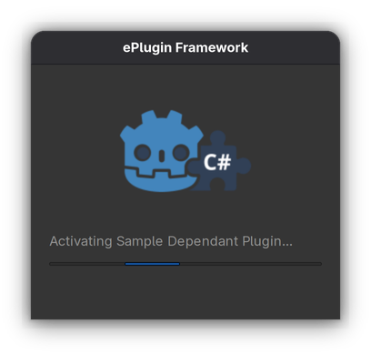

# Progress dialog

ePlugin Framework shows progress in a separate native window while plugin work runs. Its helper process keeps the window responsive even when a synchronous recipe install, uninstall, or C# build blocks Godot's editor UI. The ePlugin Manager's status line reports the result of the operation.



## Using the dialog

The window opens automatically for enabling and disabling plugins, retrying failed plugins, **Check for updates**, downloading and validating update packages, and installing updates. Start these actions in the [ePlugin Manager](eplugin-manager.md); enabling or disabling an ePlugin from Godot's Project Settings also reports progress through the framework's lifecycle helpers. Other C# editor tools can report their own work through `EPlugin.Progress`.

The window displays an animated progress bar and the current step. The bar indicates that work is running; download steps can also show a percentage in their text. It appears without taking keyboard focus from the editor and has no close or cancel button. Use the manager's **Cancel** action when it is available, such as during update downloads. The window closes automatically when the operations using it finish.

Opening starts with the ePlugin logo fading in, then splitting apart as the progress panel grows between its parts. The step text and progress bar then fade in. Closing reverses the animation from its current position without pausing on the joined logo. If work finishes while the logo is paused during opening, it starts fading out immediately.

Short operations can finish without displaying a window. An operation that starts while the window is closing reverses it back into its opening animation.

The helper is initially placed over the editor that starts it, with a screen-center fallback when placement information is unavailable. A shared helper keeps that placement while it serves other editors.

## Requirements and installation

Release archives include `addons/ePlugin/progress/ActivationProgress.dll` and its `.runtimeconfig.json`. The helper uses the installed .NET runtime and native desktop UI:

| Platform | Window implementation |
|---|---|
| Windows | Win32 |
| macOS | AppKit |
| Linux | GTK 3, with a desktop display available |
| Headless editor | No progress window |

A normal build of this repository generates the helper from `src/activation-progress/`. Publishing it is best effort, so a missing helper does not prevent framework work. See [Requirements and installation](../README.md#requirements-and-installation) for installing the framework.

## Concurrent operations and multiple editors

Each independent operation is a user of the progress window. Nested dependency work belongs to the enclosing operation. Concurrent operations can share the window, which shows the most recently reported text of the users that are still active. When one operation finishes, the others keep the window open.

Godot editors using the same editor data directory and compatible progress transport versions share one helper, including editors with different projects open. Editors with incompatible transport versions use separate helpers and can show separate windows. Sharing depends on the progress transport version, rather than the framework's release version alone.

## Timing and restarts

| Timing | Behavior |
|---|---|
| Heartbeat every 5 seconds | Keeps each active user's progress alive while the editor thread is blocked |
| 15 seconds without a report | An unheld user stops keeping the window open |
| Restart hold of up to 5 minutes | Keeps the restarting operation active while its editor is replaced |
| 15 minutes since the last message | The idle helper exits after a brief drain for late messages |

The window starts its closing animation as soon as all users end; it does not wait for the 15-second timeout. It hides when that animation finishes. The helper normally remains available in the background so later operations can reuse it without starting another process.

During an update restart, the editor holds its current progress user and writes a handoff marker under `.godot/eplugin/progress/`. A restarted editor with a compatible helper reads that marker once and resumes the same user. Its first message restores the normal timeout. If another restart is needed, the framework can hold and hand over the user again.

The helper runs from an immutable cached copy under Godot's editor data directory, `eplugin/progress/runtime/`. This lets a framework self-update replace the addon directory without waiting for the helper to release loaded assemblies on Windows. See [Builds, restart, and recovery](updating-plugins.md#builds-restart-and-recovery) for the update workflow.

## Failure handling

Progress feedback is best effort. A helper launch failure, failed command, inaccessible command file, or failed restart handoff does not fail plugin work. The manager and framework logs remain the places to check the operation's result. A progress window disappearing does not itself mean the operation finished or failed.

When connecting, the framework tries the oldest running compatible helper whose command file it can open. Missing or inaccessible command files are skipped, and records of exited helpers are discarded.

If a connection fails after its helper has run for at least 30 seconds, the framework can replace it immediately and resend the active users' text. When a worker thread (a heartbeat or a progress report) notices the failure, it only connects to another running helper; launching the replacement is left to the next command from the editor thread. A helper that fails earlier is retried only after all current progress users finish and another operation starts. Recovery makes at most two connection/send attempts per command. If the replacement also fails, retries stop until all current users finish and another operation starts.

During a C# assembly reload, the old assembly stops its heartbeat timer. Users left behind stop keeping the window open after the normal timeout. A restart hold can keep a user active longer. The helper itself has a bounded idle lifetime, so an abandoned editor does not leave it running indefinitely.

## Reporting progress from a C# editor plugin

Use `EPlugin.Progress` from the public `Enaweg.Plugin` namespace. The service implements `IEPluginProgress`; `Begin` returns an `IEPluginProgressScope`, which implements `IProgress<string>` and `IDisposable`. These types are available in editor builds (`#if TOOLS`) and can be used by separately compiled plugins that reference ePlugin Framework. The service does not look up the framework's editor node and does not require the caller to implement `IEEditorPlugin`.

Begin on the editor thread so the framework can launch a native helper if needed. Keep the scope alive until all work finishes, including awaited work, and pass it directly to methods accepting `IProgress<string>`:

```csharp
using Enaweg.Plugin;

using var progress = EPlugin.Progress.Begin("Importing assets...");
progress.Report("Reading files...");
await ImportAsync(progress, cancellationToken);
progress.Report("Finishing...");
```

`Report` updates the step text synchronously and is safe to call from any thread. It does not post through Godot's synchronization context, so feedback can update while the editor thread is blocked. It accepts text; format a percentage into that text when your operation can measure one. The animated bar remains indeterminate.

`Begin` always returns a non-null scope, including when the native helper is unavailable. Dispose it with `using` so it ends on success, exceptions, or cancellation. Disposal is idempotent, and reports after disposal are ignored, even if a surrounding scope is still active. The operation owns its cancellation token and result; the progress service does not cancel work or restart the editor.

Nested `Begin` calls, including calls in inherited async execution flows, belong to the enclosing progress user. Each independent operation gets its own user of the shared window. An inner scope ending leaves the outer user active and keeps the latest text instead of restoring an older step. Await child work before ending its scope. Obtain new scopes for new operations after an assembly reload.

Custom scopes leave Project Settings visible. If plugin lifecycle work runs inside or alongside a custom scope, that lifecycle work can still hide Project Settings; the framework restores it once all active progress users finish.

For services that should be testable independently of the editor, inject `IEPluginProgress` and pass `EPlugin.Progress` from the editor entry point:

```csharp
#if TOOLS
using System.Threading;
using System.Threading.Tasks;
using Enaweg.Plugin;

public static class AssetImporter
{
    public static async Task ImportAsync(
        IEPluginProgress progressService, CancellationToken cancellationToken)
    {
        using var progress = progressService.Begin("Importing assets...");
        await Task.Run(() =>
        {
            cancellationToken.ThrowIfCancellationRequested();
            progress.Report("Reading files...");
            // Import assets here, checking cancellation as work proceeds.
        }, cancellationToken);
        progress.Report("Finishing...");
    }
}
#endif
```

A test can supply a fake or mock `IEPluginProgress` and scope without starting a helper process. The real service uses the same heartbeats, window sharing, timeouts, and failure recovery as framework operations.

## Reporting progress inside the framework

`ActivationProgress` is the internal implementation under `Enaweg.Plugin.Internal`, compiled for editor use with `#if TOOLS`. Consumer plugins get lifecycle progress by calling `EnableEPlugin()` and `DisableEPlugin()` and use `EPlugin.Progress` for custom work. The examples below are for framework maintainers.

Keep a scope alive for the full operation and dispose it on success, failure, or cancellation:

```csharp
using var progress = ActivationProgress.Begin("Installing plugins...");
ActivationProgress.SetText("Resolving dependencies...");
// Run dependency and recipe work here.
ActivationProgress.SetText("Building the project...");
// Run the build here. The using scope ends even if it throws.
```

Nested `Begin` calls share the enclosing user's lifetime and update its text. Disposing a nested scope does not close the outer scope's window or restore its earlier text. `ActivationProgress.SetText` outside a scope does nothing.

Scopes follow their async execution flow through `AsyncLocal`. A task started inside a scope inherits its user; an operation started outside any scope gets a separate user. For a callback or background task, report through the scope explicitly:

```csharp
using var progress = ActivationProgress.Begin("Downloading plugins...");
await Task.Run(() => progress.SetText("Downloading plugins... 50%"));
// Await the remaining work before disposing the scope.
```

`Scope.SetText` is thread-safe and ignored after disposal or once its user ends. The first active user starts the heartbeat timer, and the last one releases the connection and stops it. Internal scopes request hiding an open Project Settings dialog on the editor thread; the public adapter begins with `hideSettingsDialog: false`. A later internal scope can still hide it, including when nested inside custom work. Beginning on a worker thread leaves editor UI alone and can connect to an existing helper once the editor thread has located the shared directory; only the editor thread launches a helper.

Restart integration calls `PrepareForRestart()` inside the operation's scope before scheduling the editor restart, then `ResumeAfterRestart()` during startup before recovery and reconciliation. Held users send no further messages from the old editor. The framework's existing update workflow owns these calls.

## Transport and maintenance

`ProgressSession` publishes a helper as `<token>.helper` with its transport version, process ID, and start time, next to `<token>.commands`. Process identity includes the start time so a reused process ID is not mistaken for the helper. Editors send lines in the form `USER COMMAND [ARGUMENT]`:

| Command | Meaning |
|---|---|
| `TEXT base64-utf8` | Updates the user's current step |
| `HEARTBEAT` | Refreshes the user's timeout without changing its text |
| `END` or `CLOSE` | Ends the user |
| `HOLD seconds` | Extends the user's timeout until its next message |

Protocol 4 writers use the named mutex `Global\eplugin-progress-<token>` with a 100 ms wait limit. Without the `Global\` prefix, .NET scopes a named mutex to the terminal session on Linux and macOS, so editors started from a terminal and from the desktop would not exclude each other (protocol 3). While holding it, each writer seeks to the end of the command file and writes one complete line without buffering. A persistent `FileMode.Append` stream alone can overwrite another writer's commands. An abandoned mutex is acquired by the next writer; a mutex still busy after the wait limit drops only that command and keeps the connection, because the helper is still there and the next heartbeat or text follows within seconds. Raise `ProgressSession.Protocol` when either commands or writer coordination become incompatible.

Replay sends directly to the replacement helper, avoiding recursive recovery. Cleanup still disposes the connection if reading the helper's age fails. The helper withdraws its published record before exiting and briefly drains late commands, so an editor connecting just before shutdown can keep it alive.

The main implementation is in [ActivationProgress.cs](../src/eplugin-framework/addons/ePlugin/Internal/ActivationProgress.cs) and [ProgressSession.cs](../src/eplugin-framework/addons/ePlugin/Internal/ProgressSession.cs); native windows and command parsing are under [src/activation-progress](../src/activation-progress/). [ActivationProgressTests](../src/eplugin-framework/tests/ActivationProgressTests.cs) and [ProgressSessionTests](../src/eplugin-framework/tests/ProgressSessionTests.cs) cover scope lifetime, concurrent users and writes, failure recovery, and restart handoff. [CommandsTests](../src/activation-progress.Tests/CommandsTests.cs) cover how the helper applies commands, with time driven by the test. [progress_smoke.cs](../tools/progress_smoke.cs) exercises the published helper on a desktop session.
