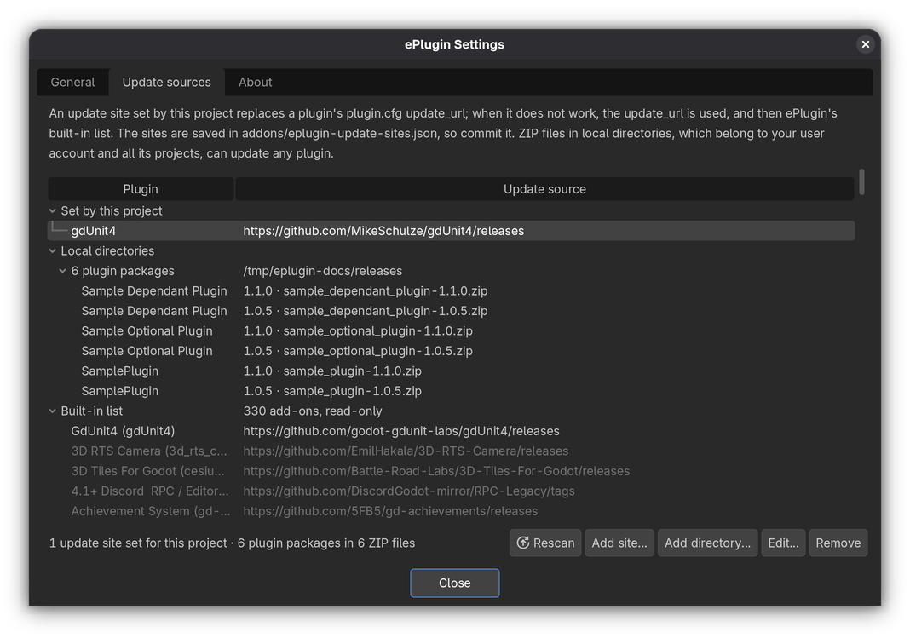
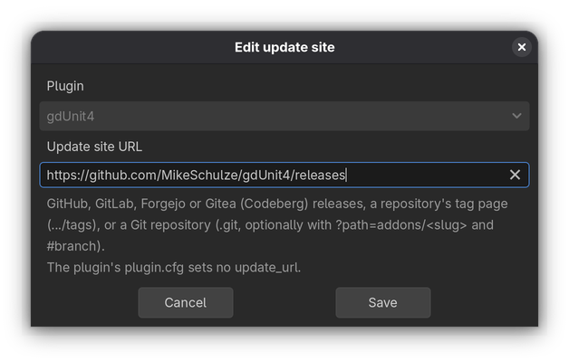
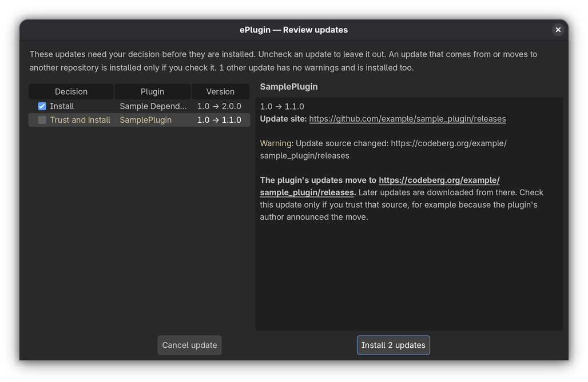
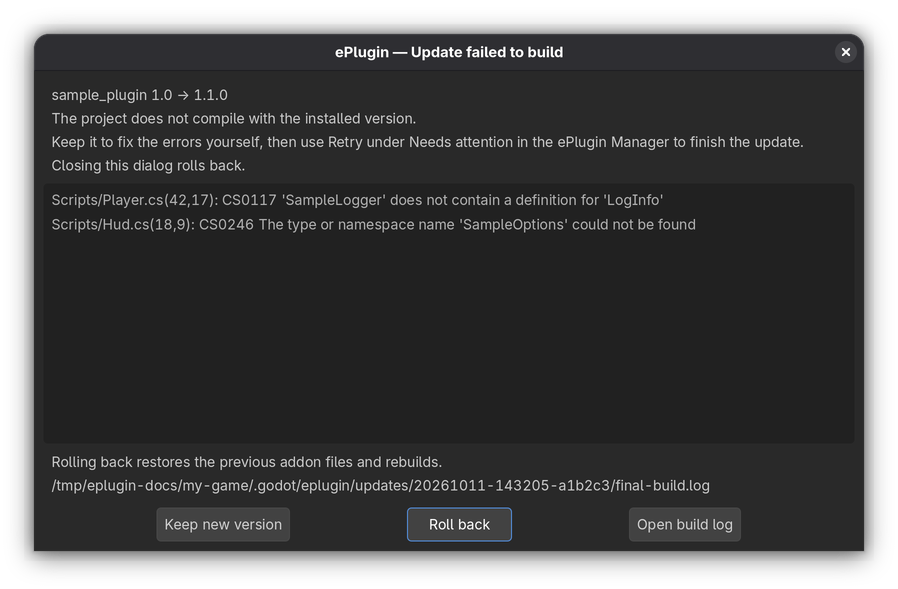

# Updating plugins

Plugins can publish updates from GitHub, GitLab, Forgejo or Gitea (such as Codeberg) releases, a Git source, or ZIP packages in a local directory. Update checks report candidates; they do not install anything until you select packages in the [ePlugin Manager](eplugin-manager.md) and choose **Update**.

## Configure an update source

Add `update_url` to the `[plugin]` section of `plugin.cfg`:

```ini
[plugin]
name="My plugin"
version="1.2.0"
script="MyPlugin.cs"
update_url="https://github.com/owner/repository/releases"
```

This works for enabled plugins of every kind: ePlugins, plain Godot GDScript, C# or [GDExtension](gdextension-plugins.md) plugins, and ePlugin Framework itself. Every one of them needs a `plugin.cfg` in its folder below `res://addons`; add-ons without one are not updated, except [GDExtensions without plugin.cfg](gdextension-plugins.md#gdextensions-without-plugincfg), whose version is the one ePlugin installed. Checks compare the source version with the version in the installed `plugin.cfg`, independently of the last working version in `addons/eplugin-state.json`. A manual version edit does not block updates; an unfinished local attempt does: checks still find the update, but it cannot be installed until the attempt is resolved under **Needs attention**. The `update_url` is read from the installed `plugin.cfg`, so each release must declare it again. To use a different update site for a plugin, for example one without an `update_url` or someone else's plugin, set it for the project instead; see [Project update sites](#project-update-sites).

Supported source examples:

| Source | Example |
|---|---|
| GitHub releases | `https://github.com/owner/repository/releases` |
| GitLab releases, including self-hosted instances | `https://gitlab.example/group/subgroup/repository/-/releases` |
| Forgejo and Gitea releases, such as Codeberg's, including self-hosted instances | `https://codeberg.org/owner/repository/releases` |
| Git tags, for repositories that tag releases without ZIP assets | `https://github.com/owner/repository/tags`, `https://gitlab.example/group/repository/-/tags`, `https://codeberg.org/owner/repository/tags`, or `https://host/owner/repository.git` |
| Git subtree tracking a branch | `https://host/owner/repository.git?path=addons/my_plugin#main` |
| Git over SSH | `git@host:owner/repository.git?path=addons/my_plugin#main` |
| Local directories | ZIP files in folders you choose; no `update_url` required |
| Project update sites | Any of the above, set by the project for a plugin; replaces its `update_url` |
| Built-in update sites | ePlugin's list of popular add-ons, for plugins that name no working update site |

Release sources select the highest semantic version and a ZIP asset. A release's version is its tag; when the tag is no version, such as `4.x-v2.1.2`, it is the first word of the release's title that is one (`4.x - v2.1.2`), else of the tag; words are split at spaces and `_` (`v1.1.6_godot_4.6`), and a word that is no version also at `-` (`godot4-v1.4.4`, while `v2.0.0-beta` stays a prerelease). A release that GitHub, Forgejo or Gitea does not mark as a prerelease is a stable version even when its tag has a suffix, unless the suffix names a prerelease stage (`alpha`, `beta`, `rc`, `pre`, `preview`, `dev`, `nightly`, `snapshot`, `canary`, `test`, `experimental`, `unstable` or `wip`, also followed by a number, such as `beta1` or `rc.2`): such a release is announced without the suffix, so `v9.8.0-4` (a build for Godot 4) is version `v9.8.0`. GitLab marks no prereleases, so there, as for Git tags, the suffix alone decides. A check reads up to the 100 newest releases, more than the first page only while none of them is a version the installed one is offered. A version right after the word Godot is the engine's and skipped (`v2.0.2 for Godot 4.4+`); any other number after the version makes the title name none (`Release candidate 1.0.0 - 7`). Several releases of the same version, such as a build for Godot 4 next to one for Godot 3, count as one version: the newest of them is announced, and installing it tries their ZIPs in that order and installs the first that validation accepts (R28 names it). A releases page at `https://host/owner/repository/releases` on any host other than GitHub is read through the Forgejo/Gitea API (`/api/v1`), which Forgejo and Gitea share. If there are several assets, the updater prefers the ZIP named exactly like the slug (`lua-gdextension.zip` next to `lua-gdextension+luajit.zip`), then a slug-named ZIP (`-`, `_` and `.` count as the same, so `godot-servo-1.2.zip` matches `godot_servo`), then an addon-, plugin- or GDExtension-named one; among several such ZIPs, demo, example, sample and tutorial ZIPs are left out, and of those left one named like an add-on, plugin or GDExtension is preferred (`limboai+v1.8.1.gdextension-4.6.zip` next to LimboAI's engine builds and export templates). If none is suitable, or several are equally suitable, it uses the release source archive. Git sources without a `#ref` choose the newest semantic tag, falling back to the default branch. Every tag named like a version is a version, with an optional `v` and two to four numbers, such as `v1.2.3`, `1.2.3`, `v1.2`, `1.2` or `1.2.3.4`, plus an optional prerelease suffix after a `-` and build metadata after a `+`. The tag's name announces the version, and it is installed from the commit the tag points to. A repository's tag page, such as `https://github.com/owner/repository/tags` or GitLab's `.../-/tags`, stands for the repository `https://host/owner/repository.git`; this works for any host, nothing is GitHub- or GitLab-specific. Without `?path=`, the plugin folder is found like in a ZIP package: the folder of the shallowest `plugin.cfg`, which must be named like the plugin's slug when it is below the repository root (such as `addons/my_plugin/` next to a `project.godot`). In a repository with several plugins, such as a project with sample plugins, the slug chooses: only the shallowest folder named like the plugin's folder in `res://addons` is installed. Use `?path=` when no folder has that name or several equally deep ones do. A branch follows its tip; a tag or full commit SHA pins the source and opts out of update checks. Checks are version-based, so changing a commit without increasing `plugin.cfg`'s version does not offer an update. Use **Reinstall** in the [ePlugin Manager](eplugin-manager.md) to install the current commit anyway.

Git sources require **git 2.25 or newer** on PATH. Fetches use shallow, partial, sparse checkout of the requested subtree. Servers that do not advertise partial-clone filtering are refused. Git release checks can read remote metadata directly; other Git checks fetch only the metadata blob. Release ZIP sources do not require git. A ZIP download fails when it receives nothing for 60 seconds; how long it takes in total is not limited.

For private release APIs, set `EPLUGIN_GITHUB_TOKEN` (fallback `GITHUB_TOKEN`), `EPLUGIN_GITLAB_TOKEN` (fallback `GITLAB_TOKEN`) or `EPLUGIN_FORGEJO_TOKEN` (fallback `FORGEJO_TOKEN`, then `GITEA_TOKEN`; Forgejo and Gitea share it) in the editor environment. Tokens are not written to project files or caches. HTTP credentials are scoped to the source host and stripped on redirects to another host. Because any installed plugin can name an update site in its `plugin.cfg`, each token is only sent to the hosts it belongs to: the GitHub token to GitHub, the GitLab token to `gitlab.com` and the Forgejo token to `codeberg.org`. For a self-hosted GitLab, Forgejo or Gitea, list its host names, separated by commas, in `EPLUGIN_GITLAB_HOSTS` or `EPLUGIN_FORGEJO_HOSTS` (for example `EPLUGIN_GITLAB_HOSTS=git.example.org`); other hosts are contacted without a token. Git authentication uses normal Git or SSH credentials and runs without interactive prompts. An ssh command you configured yourself (`GIT_SSH_COMMAND`, `GIT_SSH` or `core.sshCommand`, e.g. for plink or an SSH agent) is used as it is; otherwise ssh runs in batch mode, so a passphrase or unknown host key fails instead of waiting. A Git fetch or checkout may take up to 5 minutes, other Git commands 1 minute.

## Project update sites

A project can set the update site of a plugin itself, on the **Update sources** tab of the [ePlugin Manager](eplugin-manager.md)'s **Settings**. Use it for a plugin whose `plugin.cfg` has no `update_url`, or whose `update_url` changed and no longer finds updates. The project's update site replaces the plugin's `update_url` for checks, versions and downloads.

- **Add site...** chooses a plugin in `res://addons` from a list and asks for the update site URL.
- **Edit...** (or double-clicking an entry) changes the URL of the selected plugin.
- **Remove** deletes the selected site; the plugin uses its `update_url` again.





The URL can be any [supported source](#configure-an-update-source): GitHub, GitLab or Forgejo releases, or a Git repository. Other URLs are refused when you save them. The editor shows the plugin's `plugin.cfg` `update_url`, which stays the fallback; so does the site's tooltip in the list.

The project's update site is always tried first. When it does not work, the plugin's `update_url` is checked instead, and then its [built-in update site](#built-in-update-sites): for example when the site does not respond, returns an error, or is not a supported URL because the file was edited by hand. The output log and the manager's status line say when this happened. A plugin with no other site reports the failed check.

The update sites are saved in `res://addons/eplugin-update-sites.json`. Commit the file, so everyone working on the project uses the same sites. The file is removed again with its last entry. A file that cannot be read, or that a newer ePlugin version wrote, is never overwritten: the sites can only be changed again once it is repaired or deleted.

```json
{
  "schema": 1,
  "sites": [
    { "slug": "gdUnit4", "url": "https://github.com/MikeSchulze/gdUnit4/releases" }
  ]
}
```

An update replaces the plugin's `plugin.cfg`, but not the project's update site, which stays in use. A new release that changes its own `update_url` to another repository, or removes it, has to be trusted in the [review](#review-before-installation) all the same: checks fall back to the `update_url` (or, without one, to the [built-in update site](#built-in-update-sites)) whenever the project's site does not work. The plugin details in the manager show the project's update site and the `update_url` it replaces.

## Built-in update sites

ePlugin ships a list of update sites for popular Godot add-ons. It is the last fallback: a plugin uses its built-in update site only when the project sets no update site for it and its `plugin.cfg` names no `update_url`, or when those do not work. So the add-ons in the list get updates even when they do not declare an `update_url` themselves. The list also fills in the documentation, source and website links of the plugin details when `plugin.cfg` does not set them.

The list matches add-ons by their folder name in `res://addons`. It holds active add-ons with at least 20 stars on GitHub or at least 5 on GitLab or Codeberg, plus add-ons listed explicitly in `tools/extra_addons.txt` (from any git host), that publish a release or tag their versions in git (prereleases included); for the latter it names the repository's tag page. Each add-on's folder name is the plugin folder in its latest release's ZIP or, without one, in its repository at that release or tag. A GDExtension without `plugin.cfg` counts as a plugin folder. GitLab and Codeberg add-ons come from those hosts' searches for Godot projects, which also find games, so they are listed only when their plugin folder is named like the repository. Add-ons without a plugin folder, add-ons whose release ZIP the updater would refuse, add-ons whose name says they are made for Godot 3 (unless their repository at that release shows Godot 4), and add-ons whose folder name is too generic to tell them from a project's own folder (such as `plugin` or `log`) are not in the list. The listed releases are not installed in advance, so an update found through the list is still validated and can be refused like any other. Because the list matches by folder name only, an update it finds for a plugin whose `update_url` names another repository (its own site did not work) may be someone else's add-on with the same folder name: the review leaves it unchecked until you trust it.

The list is read-only. The **Update sources** tab of the [ePlugin Manager](eplugin-manager.md)'s **Settings** shows it below the project's update sites, with the installed add-ons first, so you can review which site each add-on uses. To use a different site for an add-on, set a [project update site](#project-update-sites); it is tried first. To ignore the list entirely, turn off **Built-in update sites** on the **General** tab of the settings (`eplugin/updates/builtin_update_sites`).

## Local directories

Local directories provide ZIP packages from a folder, network share, or downloaded release collection. A local directory is an update source for any plugin: one directory usually holds the packages of many plugins, so you typically need only one. Add it with **Add directory...** on the **Update sources** tab of the [ePlugin Manager](eplugin-manager.md)'s **Settings**, which lists each directory with the packages found in it. **Remove** removes the selected directory from the list without touching its files. The list is stored in `eplugin/local-sources.json` in the Godot editor's user configuration folder, shared by projects, and never written to a project. A missing directory remains in the list for when a drive or share returns.

At editor startup and after C# assembly reloads, the framework indexes `*.zip` files in these directories and their subdirectories in the background. It reads each archive's file list and `plugin.cfg`, not the full archive. A cache in `eplugin/local-index.json` remembers each ZIP's metadata, so only new or changed ZIPs are opened again. Deleting the cache is safe. Adding or removing a directory, choosing **Rescan**, or selecting **Check for updates** indexes again. Hidden and system folders and folder links are skipped. ZIPs without a `plugin.cfg` are ignored; unreadable archives appear in the dialog with a status and are logged when first found.

A ZIP holds one plugin. The plugin root is the folder of its shallowest `plugin.cfg`, and that folder name is the plugin slug, for example `addons/my_plugin/` or `my_plugin/`. Deeper `plugin.cfg` files are sub-plugins and ship with it. A `plugin.cfg` at the archive root, or any other plugin root, makes the ZIP ambiguous and it will not be indexed. Local packages also work for plugins without an `update_url`. If both sources provide a version, the higher version wins and a local package wins a tie. Local packages use the same validation, backup, and rollback as downloads; their files are read in place and never changed. To install a single ZIP file without adding its folder, use **Install from ZIP** in the [ePlugin Manager](eplugin-manager.md#install-a-plugin-from-a-zip-file); it also installs plugins that are not in the project yet.

## Publish an updatable release

Keep the addon slug stable and include `plugin.cfg` and its entry script. A ZIP must contain exactly one plugin root. The folder containing its shallowest `plugin.cfg` should be named for the slug (such as `addons/<slug>/`), unless it is at the archive root or inside one wrapper folder, as in a repository source archive. Nested `plugin.cfg` files below the plugin root belong to sub-plugins; any other plugin root makes the package ambiguous.

Packages may not contain submodules (`.gitmodules`), `project.godot`, or `nuget.config`; symlinks in a package are left out. New `.csproj`, `.sln`, and `.slnx` paths are refused, though existing addon project paths can be updated. Packages made for Godot 3 are refused (R27): GDNative libraries (`.gdnlib`, `.gdns`) and scripts in Godot 3's GDScript (a bare `tool` line, `export var` or `onready var` without `@`). Downloads are limited to 256 MiB; extracted packages to 1 GiB, 20,000 files, and 256 MiB per file. Plugins with `.gdextension` files, ePlugins included, are updated file by file, next to the copies of their libraries that the editor loads. See [GDExtension plugins](gdextension-plugins.md#publish-a-release) for their rules.

Bump `version` for every release. Versions accept two to four numbers (`1.2`, `1.2.3` or `1.2.3.4`), an optional leading `v`, any prerelease suffix after a `-` (`1.2.3-beta.1`, `1.2-anystringhere`), and build metadata after a `+`. Versions compare by their numbers; a version with a suffix is a prerelease and comes before the same numbers without one (`1.2.3-beta.1` < `1.2.3`), and suffixes of equal numbers are ordered like semantic prereleases. The suffixes `-stable`, `-release` and `-final` are no prereleases: `1.4.0-stable` is version `1.4.0`. Build metadata is ignored. Versions are shown as they are written. An update always moves to the next better version of the same kind: a stable version is updated only to a newer stable version, a prerelease to any newer version (a newer prerelease or the release). The version list in a plugin's details lists every version, prereleases included, so a stable version can be changed to a prerelease there. The version decides what is a prerelease, except that a release on GitHub, Forgejo or Gitea that its host does not mark as one is stable unless its suffix names a prerelease stage (see [Configure an update source](#configure-an-update-source)); a release marked as a prerelease without a suffix is still stable. The staged `plugin.cfg` version must be newer than the installed one; if it differs from the release tag, the manager reports the difference for review.

For ePlugin recipes:

1. Keep root code compilable using only Godot and ePlugin. Code needing new NuGet packages or project references belongs in managed directories or projects declared by the recipe.
2. Ship managed source directories in hidden form, such as `.src`.
3. Keep `CreateRecipe` deterministic and free of side effects. During an update, the framework loads the new assembly and reconciles the old and new declarations.
4. Treat public API changes as changes that may require updates in users' game code. Major updates show a warning; hard dependency constraints that reject the new version block the update.

An enabled ePlugin stays enabled during its update. Its existing visible resources remain available for an interim build; the new recipe is reconciled before the final build. Plain plugins are temporarily toggled during the swap. Optional recipes that stop matching are reported and retained until their owning plugin is toggled; newly satisfied optional recipes are applied during reconciliation.

Before swapping addon files, the updater saves and closes open scenes so no scene keeps nodes whose scripts or resources are missing during the change. Untitled scenes cannot be saved, so an update will not start while one is open. Closing scenes requires Godot 4.5 or newer; on Godot 4.4 scenes are saved but remain open, and an untitled scene does not stop the update. Reopen scenes after the update. An update also does not start while a scene is running, or while an ePlugin in the batch has not finished enabling.

## Checks and installation

The update list is part of ePlugin Manager. Select updates with the checkboxes in the **Version** column, then use the bottom **Update** button to install the batch.


This screenshot uses example local ZIP releases of the repository's sample plugins; the displayed update versions are sample data.

By default, the framework checks once per editor session when the last successful check was at least 20 hours ago. Results and the timestamp are cached under `.godot/eplugin/update-state.json`. The manager's **Check for updates** action bypasses the interval and also indexes local directories. The settings are on the **General** tab of the manager's **Settings** and under **Project Settings > eplugin/updates**; see [Update settings](#update-settings).

The manager shows installed and candidate versions, sources, warnings, and earlier failures. Select a batch and choose **Update** to download and validate it. Packages with warnings, another repository, or a refusal are shown in the **Review updates** dialog before anything is installed (see [Review before installation](#review-before-installation)). Canceling the download leaves installed addons untouched. An update that comes with a license file not accepted yet shows it before installation; an update that keeps the accepted license file does not ask again (see [Plugin licenses](plugin-licenses.md#updates)). Updates never show a plugin's [welcome page](plugin-welcome.md#updates). Previously failed versions are shown but are not selected automatically. The **Version** selector also supports installing an earlier published version as a downgrade, and installing the installed version again with **Reinstall**, both with the same validation, backup, and rollback flow. Reinstalling picks up new commits of a Git branch whose `plugin.cfg` version did not change, and restores addon files that were changed by accident in the project.

Versions are listed from GitHub, GitLab or Forgejo releases (up to 100) or semantic tags of a Git source. A Git `update_url` pinned to a branch, tag, or commit, or a repository without semantic tags, lists the one commit it points to now, with the version in its `plugin.cfg`. When the list loaded for the selected plugin contains a version newer than the installed one, the plugin shows that update right away, as if **Check for updates** had found it. Configure **Update**, **Downgrade** and **Reinstall** from [ePlugin Manager](eplugin-manager.md).

### Review before installation

**Update** first downloads and validates every package of the batch. Addon files are only changed afterwards. When a package has a warning, comes from or moves its update source to another repository, or was refused, the **Review updates** dialog opens before anything is installed. It lists only those packages, not the whole batch: each with its version change, update site, release link and findings, and a check box that decides whether it is installed. Updates with warnings are checked, so you only uncheck the ones to leave out. An update that moves to another repository or removes its `update_url`, or comes from another repository because the plugin's own update site did not work and the [built-in list](#built-in-update-sites) named another, is unchecked: check it (**Trust and install**) only if you trust the new source, because later updates are downloaded from there. Another repository on the same host (another GitHub owner, for example) counts; the same repository named by a release page, a tag page or a git URL does not. A refused package cannot be checked; the dialog says why. The other updates of the batch have nothing to review and are installed together with the checked ones. **Cancel update** installs nothing. The same dialog reviews a version chosen in the **Version** selector.



| Warning | Reason |
|---|---|
| Package version differs from the announced version | The `version` in the package's `plugin.cfg` is not the version of the release or tag that offered it. |
| Release announced as newer, but not inside | The release or tag offers a newer version, but its `plugin.cfg` still names the installed version (or an older one, except for ePlugin Framework), usually because its author forgot to raise it. Confirming installs it anyway: the files are replaced and the installed version stays what `plugin.cfg` says. That release is not offered again afterwards. |
| Plugin name changed | The package's `plugin.cfg` has a different `name`. |
| Update source changed | The package's `plugin.cfg` has a different `update_url`, or none. Another repository, or none, has to be trusted in the review, also when the project sets an update site: checks fall back to the `update_url` when that site fails, and without one to the built-in list, which matches by folder name only. |
| Update from another repository | The update was found at an update site of another repository than the plugin's `update_url`, through the built-in list. It has to be trusted in the review. |
| Plugin entry-point language changed | The `script` changed language, for example from `.gd` to `.cs`. |
| Major version change | The major version differs, so project code that uses the plugin may need changes. |

An update with an error cannot be selected or installed. These are refused:

- a package without a readable `plugin.cfg`, without `name`, `version` or `script`, or whose script is missing or outside the addon (a [GDExtension without `plugin.cfg`](gdextension-plugins.md#gdextensions-without-plugincfg) needs only its `.gdextension` file, and its version is the release's or tag's)
- a package for a different addon slug
- a version that is not newer than the installed one, unless the release announced a newer version (see the warning above). The **Version** selector can downgrade, except ePlugin Framework, and reinstall the installed version.
- a GDExtension whose libraries are outside the plugin folder or missing for the editor's platform, or that the editor's Godot version cannot load (see [GDExtension plugins](gdextension-plugins.md#publish-a-release)), a forbidden file, or a package over the size limits (see [Publish an updatable release](#publish-an-updatable-release))
- a version rejected by a hard dependency constraint of another enabled plugin
- a plugin folder that is a link (a symlink or junction to another checkout); update the plugin where it points to
- a plugin whose update is changed or blocked: its `update_url` changed since the check, it is no longer enabled, or an earlier attempt still waits for a decision under **Needs attention**

Some of these can only be found once the package is downloaded, for example a release whose plugin script is missing. Such a package is shown as refused in the **Review updates** dialog and left out of the batch; the other selected updates are still installed, and the manager lists the skipped package after them. Only when every package of the batch is refused is nothing installed.

Shown without stopping: an optional recipe of another plugin that no longer matches the new version (it stays installed until that plugin is toggled), and the last working version recorded in `addons/eplugin-state.json` when it differs from the installed one.

> [!NOTE]
> An update replaces the whole addon folder, `plugin.cfg` included. If you added `update_url` to a third-party plugin yourself, its next release usually does not contain it: the review reports **Update source changed: removed** and leaves the update unchecked until you trust it, and after installing, the plugin has no `update_url` until you add it again. Set a [project update site](#project-update-sites) for plugins whose releases do not declare an `update_url`; it stays in use across updates.

## Builds, restart, and recovery

A batch is installed in groups, one after another. Plugins that depend on each other, also through plugins that are not updated, share a group, because a dependant may need its dependency's new version to compile; every other plugin is a group of its own, and an ePlugin Framework self-update always goes first. Each group is a transaction of its own: it is built and verified, and when it fails only that group is rolled back while the remaining groups are still installed. The manager then lists what was installed and, per group that was not, why and where its logs are. Installing many plugins takes slightly longer this way, because each group with C# code is built on its own, but the editor restarts at most once, after the last group.

Each group has a durable journal, old addon trees, project backups, and build logs under `.godot/eplugin/updates/<id>/`. A local state marker is written before file changes. The shared `addons/eplugin-state.json` advances for a group's plugins after that group builds and verifies successfully. Commit that index with the updated addon files. Backups are removed after success; failed updates retain logs. When a group finishes, the backups of the groups still waiting for the restart are refreshed, so rolling one of them back later keeps the finished group's project changes.

Installation failures and self-update failures roll back automatically. A build failure rolls back too, except for an update started with the **Update** button in a plugin's details (also **Downgrade** and **Reinstall** from the **Version** selector): that one offers **Roll back**, **Keep new version**, and **Open build log**, whether the interim or the final build failed. Keep the new version when the project has to be adapted to it, for example project code using an API the new version changed. Updating the checked plugins with the manager's main **Update** button never asks and, with the default `on_build_failure=ask`, rolls every failed group back, and a batch of several groups always rolls the failed group back, because a project that does not build would fail every later group. The exception is a build that fails only in the project's own code, described [below](#updates-that-only-break-the-projects-code). Closing the dialog rolls back; closing the editor while a decision is pending preserves it for the next startup. Headless execution always rolls back. Keeping a failed version retains its backup and an `update_kept_build_failed` local marker without advancing the shared index. Fix the build and use **Retry** under **Needs attention** in the manager: it builds the project and, when it compiles, finishes the update. An update kept after its interim build restarts the editor into the new code first and then applies the new recipe (NuGet packages, projects, directories, autoloads), builds again and acknowledges the version; a rollback from then on keeps the project files as they were at the retry. If the shared index changed externally, merge it and retry acknowledgement.



The dialog lists the errors of the build log; the plugin, errors and paths in the screenshot are sample data.

C# updates may restart for the assembly handoff, and so do updates of [GDExtension plugins](gdextension-plugins.md#updates) whose extension cannot be reloaded in place; managed C# recipes restart after their final build, and ePlugin Framework self-updates always restart. If automatic launch fails, reopen the project to resume its journal. When the helper is available and compatible with the restarted editor, the progress window stays open across these restarts until the resumed workflow finishes: the editor holds it for up to 5 minutes until the restarted editor reports again. Progress feedback is best effort; a missing or incompatible helper does not prevent the update from resuming. Its helper runs from a cached copy in Godot's editor data folder (`eplugin/progress`), so a self-update can replace the addon without closing the window to release Windows file locks. Outside a restart hold, the window closes when no active operation has reported for 15 seconds, e.g. because its editor ended. Early recovery runs before framework initialization: after two startups without a health marker, it restores the prior framework, rebuilds it, clears its local marker, and requests a restart.

See [Progress dialog](progress-dialog.md) for window sharing, restart timing, and helper failure handling.

If automatic recovery cannot run, close the editor, restore `.godot/eplugin/updates/<id>/backup/<slug>` to `addons/<slug>` for each affected plugin, and restore files from `backup-project/` to the project root. Delete `.godot/mono/temp` and rebuild the solution. Reopen the editor and use **Retry** under **Needs attention** in the ePlugin Manager; keep the journal and local marker until recovery succeeds. Each transaction includes a `README.txt` with these steps.

### Updates that only break the project's code

A new plugin version can change an API the project's own scripts use, while the plugin and every other addon still compile. Rolling such an update back would never let you adapt the project to it. When a build fails, ePlugin therefore reads where its errors are:

- Errors only in the project's own C# files (anything outside `addons/` and outside the projects that recipes declare): the project is built once more without them, as a *plugins-only build*. When the plugins compile on their own, the update is **kept** instead of rolled back, also from the main **Update** button and in a batch of several groups (later groups that fail with the same project errors are kept the same way). An update started from a plugin's details still asks, with **Keep new version** preselected.
- Any error in plugin code, in a project file, in generated code, or without a source file (NuGet, MSBuild): the update rolls back as before. So does a plugins-only build that fails, e.g. a project addon that uses the game's code.
- Errors that may pass on another attempt (a locked output file, an unreachable package source): the build runs once more first.

The plugins-only build writes to the update's folder, never to the assembly the editor loads, and changes no project files. A kept update keeps its backup and an `update_kept_build_failed` marker like **Keep new version**. The manager's status line says it was kept and why. The plugin then needs attention: its details and the **Needs attention** dialog list the remaining errors in the project's code (refreshed by every **Retry**), and the dialog's **Roll back** restores the previous version. That rollback keeps the project files (`.csproj`, `.sln`, `nuget.config`) you changed while fixing an update kept before its recipe was applied; an update kept after its final build restores them as they were before the update. If you already adapted the project's code to the new version, it no longer builds with the old one. Self-updates, headless runs, `on_build_failure=rollback` and `keep_on_project_errors=false` always roll back. GDScript code is not built, so a plugin update that breaks GDScript is not noticed here.

When a build fails, the editor keeps running the code it loaded. ePlugin also puts the built assembly back after a failed non-incremental build (which removes it before compiling), so the editor still loads the C# plugins, including the ePlugin Manager and its **Needs attention** dialog, after a restart.

## Update settings

The **General** tab of the [ePlugin Manager](eplugin-manager.md)'s **Settings** shows these settings, which are also listed under `eplugin/updates` in **Project Settings** (with **Advanced Settings** shown). They are stored in `project.godot`.

| Setting | Default | Effect |
|---|---|---|
| `check_enabled` | `true` | Enables scheduled checks; manual checks remain available. |
| `check_interval_hours` | `20` | Minimum time between successful scheduled checks. |
| `on_build_failure` | `ask` | Build failure policy: `ask` asks for an update started from a plugin's details and rolls back otherwise, `rollback` never asks, `keep` keeps every failed batch of one group; self-updates, headless runs, and batches of several groups always roll back, except for [updates that only break the project's code](#updates-that-only-break-the-projects-code). |
| `keep_on_project_errors` | `true` | Keeps an update whose build fails only in the project's own code while its plugins compile on their own (see [above](#updates-that-only-break-the-projects-code)), unless `on_build_failure` is `rollback`. |
| `restart_policy` | `auto` | Uses conservative C# restarts, or `always` to restart for every batch. |
| `builtin_update_sites` | `true` | Uses ePlugin's [built-in update sites](#built-in-update-sites) for plugins that name no working update site. |

Update journals and recipe snapshots use versioned, backward-compatible readers. Future framework releases must preserve that contract and keep the shared and local state schemas readable by a rolled-back framework. Unsupported future journals need manual repair. Updates do not install missing addons, resolve remote plugin dependencies, or run migration scripts; a new plugin is installed from its ZIP file with [Install from ZIP](eplugin-manager.md#install-a-plugin-from-a-zip-file).

How the updater is built (sources, staging, groups, journals and recovery) is described for maintainers in [Update system internals](internals/update-system.md).
